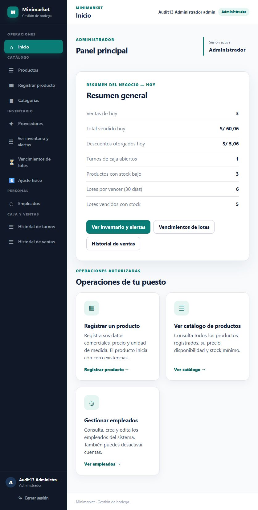

# Etapa 13 · Panel mínimo, consultas y reportes futuros

> **FINALIZADA · primera pasada · 13/11/2026, Lima.** El cierre comprende el panel mínimo de Inicio y las consultas que explican sus cifras, enlaces, mensajes y permisos. La sección 10 registra la prueba final en navegador y la evidencia compatible de servidor y PostgreSQL. Las secciones 1–9 conservan los cortes parciales anteriores. La etapa 14 es la siguiente y está sin ejecutar. [Cierre y pruebas](#cierre-13-b-final).

**Primera pasada · 13/11/2026, America/Lima · sublote 13-A. Estado: PARCIAL; no cierre de etapa.** Se inventarió el tramo completo solicitado y se ejecutó el panel mínimo con datos aislados. El recorrido visual inicial cubrió los tres roles; la validación de servidor incluye el build corregido. La revalidación visual de las correcciones, los vacíos en navegador y PostgreSQL quedan para **13-B**. No se declara terminado ningún otro módulo.

## 1. Alcance, contrato y versión

Se leyeron completos [protocolo](../PROTOCOLO_COMUN.md) y [continuidad](../CONTINUIDAD_Y_SEGUNDA_PASADA.md), y el estado vigente. No existía ETAPA-13; no se reetiquetan como primera pasada las conciliaciones anteriores. [Estado general al entrar](evidencias/13-A-20261113/estado-general-antes.md).

**Incluido:** identity/dashboard, marco de navegación por rol, siete cifras y sus modelos consultados, entradas a las ocho tarjetas operativas, consultas de stock/vencimientos/historial y su relación con ventas/lotes/turnos. HU-DASH-01..05, HU-REP-01..09, HU-CONF-01..02, sus 39 CA y fuentes/tareas pertinentes fueron clasificados. No hay AGENTS.md localizado en el workspace. PLANIFICACION_SCRUM_R1PMV.xlsx no está presente en la raíz y no se utilizó como fuente ni se modificó.

**Contrato vigente:** RN-06, RN-29, DEC-07-VENCIDOS-FILTRO/C-01..03 y CT-COHERENCIA-UI/C-01..04. Las 16 HUs solicitadas y sus 39 CA completos son **PREVISTO/FUTURO**, MoSCoW W, con refinamiento pendiente. El panel mínimo aceptado previamente no equivale a entregar esas HUs. La ventana actual de 30 días no incumple la futura alerta DASH-03 de 7 días. El contador OPEN tampoco implementa una alerta de inactividad de dos horas.

**Excluido de aceptación funcional:** reportes por período/Yape, ticket promedio, ranking, gráficos, solicitudes, margen, PDF de gestión, configuración comercial/logo, integración fiscal, despliegue, datos reales, auditoría integral de los destinos y etapas14–17. No se fabricaron pantallas vacías para funciones futuras.

| Identificación | Entrada / evidencia visual inicial | Salida / servidor revalidado |
|---|---|---|
| SHA256 de08 | `08cc56a5843b15a238ac8bfca97bff2f6a905b36d216e65ca9f09eb7ac939dad` | `5735fb283b70bca02ed551e0000c72df2025eaef9b977607b1e4a2b890e5a1d9` |
| Commit de r1-pmv | `7816d3328115cf5aa5bcdd0985fffd795b3ae084` | Mismo HEAD; cambios locales conservados, sin commit ni despliegue |
| Build local SHA256, 178 archivos de código/plantillas/estilos/scripts | `9b373015f955101a19318adacadaa08cc09c7179bb72baad71db1dcbf88e40eb` | `f0918e86fad95a023c7a5fafe08ab6ebe8a61109a31669b349a5f94f13831e74` |
| Manifiesto | [baseline.json](evidencias/13-A-20261113/baseline.json), incluye estado dirty preexistente | [build-final.json](evidencias/13-A-20261113/build-final.json), seis archivos de producto/prueba cambiados en esta sesión |

El hash de build usa el mapa ordenado ruta→SHA256 de esos 178 archivos, excluyendo .git, .venv, __pycache__ y evidencias. No sustituye una imagen desplegada. Las referencias con líneas del anexo documental corresponden a08 de entrada; se conserva [planificación anterior](evidencias/13-A-20261113/planificacion/antes.zip). Ninguna captura anterior acredita automáticamente los textos o consultas modificados.

## 2. Inventario y trazabilidad en ambos sentidos

- [Inventario de planificación](soporte/13-inventario-planificacion.md): **16/16 HUs y39/39 CA** clasificados individualmente, 16 casos escritos futuros, RN/contratos, fragmentos01/02/07/08/09/03/14/16/21 y CONTROL_SPRINTS. Las tareas y estados históricos no se usaron como evidencia de funcionamiento.
- [Inventario inverso](soporte/13-superficie-inversa.md): **45/45 grupos de Inicio** trazados (10 estructura, 17 grupos de menú, 7 cifras, 3 enlaces y 8 tarjetas) y **12 grupos de destinos**. Contiene literal o plantilla/variables, rol, ruta, estado, acción, salidas, errores y respaldo. Son grupos de inventario, no45 pruebas aprobadas.
- [Servidor](soporte/13-servidor.md): consulta exacta, datos origen, límites temporales, precisión, permisos, efectos y comandos. El código ya no atribuye el panel a HU-REP-01 futura.

| Planificación / superficie | Actor y esperado | Implementación / evidencia reproducible | Resultado acotado / siguiente acción |
|---|---|---|---|
| 16 HUs CONF/DASH/REP,39CA | Capacidades futuras completas | Inventario documental; ausencia de sus controles en panel y rutas actuales | PREVISTO/FUTURO; cero HUs futuras declaradas verificadas. Refinar antes de seleccionar |
| DEC07, RN06; M01..07 | ADMIN siete cifras; ALMACENERO tres de inventario | identity.views::_dashboard_summary; 13-S-01/02/06..11, B01/02/03/06/07/11 | CUMPLE en valores de la muestra; interfaz final NO EJECUTADA |
| RN29, CT; B/N/O | Menú y tarjetas según rol, denegación real | B01/08..20; 13-S-03/04/09-OWN/12..15 | CUMPLE en casos enumerados; no certifica toda acción interna del destino |
| DEC07/C01; D02..04 | Crítico solo activo; vencido físico incluso inactivo | Datos de8 productos y14 lotes; B02/03/09; prueba catalog.test_audit03_catalogue | Hallazgo de badge corregido y regresión servidor CUMPLE; visual final pendiente |
| DEC07/C02; D06..08 | días1..3650, defecto30, límites Lima, invalidez con aviso | B03/04/13; 13-S-16 pre y post; catalog.views::product_expirations | Error500 inicial corregido; clases normales finales CUMPLE; UX del aviso final pendiente |
| DEC07/C03, CT/C03; B07/E03 | No prometer reportes futuros ni confundir diario con período | B01/B05/B06 y login inicial; nuevas plantillas en build final | Promesa «reportes» y falta de fecha corregidas; render servidor CUMPLE, visual pendiente |
| CT/C01..02, CP-DEC07-002; actualización | Borrador no suma; cobro confirmado y siguiente consulta sí | 13-S-17..24; hash antes/después y servicios reales | CUMPLE servidor serializado. Cobro completo en navegador NO EJECUTADO |
| CT/C04; vacíos y fallos | Cero real, mensajes de ausencia; error no convertido en cero | 44 comprobaciones de vacío +8 de mensajes/error | CUMPLE servidor; vacíos visuales NO EJECUTADOS |
| NFR/consistencia/volumen | Demostrar comportamiento al competir y a escala | Solo consultas SQLite y casos serializados | NO EJECUTADO PostgreSQL/concurrencia/carga; cursor13-B y coordinación15 |

No se aprueba íntegro CP-DEC-07-VENCIDOS-FILTRO-001: la reactivación combinada de categoría/producto y todas las variantes de sus pantallas no se reejecutaron aquí. CP-DEC-07-VENCIDOS-FILTRO-002 queda **EJECUCIÓN PARCIAL**. Tampoco se traslada CUMPLE al conjunto transversal CT, cuya aplicación supera esta etapa.

## 3. Cada cifra: origen, fecha, actor, precisión, actualización y enlace

Todas son salidas de lectura, no campos de entrada: no tienen obligatoriedad, longitud ni validación de formulario propia. Los conteos son enteros no negativos, las cantidades son unidades enteras y los importes se muestran en soles con dos decimales y coma decimal. Consultar no guarda valores del panel. Sin datos se muestran0 oS/0,00. El build final captura una fecha Lima por petición y presenta `dd/mm/aaaa · Lima`; se recalcula al abrir/recargar, sin polling ni promesa de tiempo real. Los parámetros ajenos de /inicio/ no actúan como filtros.

| Salida / actor | Fórmula y filtro, fuente persistida | Muestra13-A y contraste | Enlace disponible y límite |
|---|---|---|---|
| Ventas de hoy / ADMIN | COUNT Sale donde fecha Lima de confirmed_at=D; todos los vendedores/turnos | 3: D00:00, D10:00, D23:59:59.999999. Excluye D−1último instante y D+100:00. Borrador no cuenta | «Historial de ventas» abre todas las fechas; aplicar Fecha exacta=D devuelve3 |
| Total vendido hoy / ADMIN | SUM Sale.total_amount sobre el mismo conjunto; snapshot neto | 10.01+20.02+30.03=60.06; distinto de efectivo recibido y vuelto. Historial completo243.39; filtrado60.06 | Mismo enlace general; cifra no es botón ni reporte por período/Yape |
| Descuentos otorgados hoy / ADMIN | SUM Sale.discount_amount sobre el mismo día | 0.01+2.02+3.03=5.06. No restar otra vez del total. Son snapshots ficticios históricos; no valida política de nuevos descuentos | Historial muestra descuento por venta y total filtrado |
| Turnos de caja abiertos / ADMIN | COUNT CashShift con status=OPEN; sin filtro por día de apertura | 1 aunque abrió ayer; cerrado excluido. Tras cierre de servicio0; ventas del día siguen4 | Menú «Historial de turnos»; sin enlace propio junto a cifra. No representa efectivo ni turno olvidado |
| Productos con stock bajo / ADMIN,ALMACENERO | COUNT Product y Category activos; SUM cantidades Lot vencimiento>D≤minimum_stock, suma vacía0 | 3: sin lotes/mínimo0;5unidades/mínimo5; físico9solo vencido/mínimo1. Inactivos excluidos. Venta de2unidades deja1 e incrementa a4 | «Ver inventario y alertas» explica productos, unidades vigentes/físicas y umbral |
| Lotes por vencer (30 días) / ADMIN,ALMACENERO | COUNT Lot con cantidad>0 y D<expiration_date≤D+30; también inactivos físicos | 6; fronteras1y30 incluidas;31y agotado excluidos. No cuenta unidades ni productos. Filtro1en destino:2próximos | Inventario y «Vencimientos de lotes»:30por defecto, conjunta11=6+5rotulada |
| Lotes vencidos con stock / ADMIN,ALMACENERO | COUNT Lot cantidad>0 y expiration_date≤D; incluye producto/categoría inactivos | 5; hoy vencido, no se vende; cero disponible excluido. Se mantiene5con filtro días1 | Ambos destinos separan vencidos y próximos; badges explican inactividad |

Los modelos son Account/Role para sesión y actor; Sale, CashShift, Product/Category y Lot para cálculos. SaleLine fue consultado como contraste de snapshot, no como fórmula del total; InitialInventoryLoad/Supplier aparecen en destinos. No se consulta un modelo de configuración comercial ni se obtiene un logo empresarial: la marca genérica no prueba HU-CONF.

Precisión: se conserva Decimal y formato2, sin pasar a float. La primera comparación de cadenas del arnés confundió ceros decimales finales de SQLite con diferencia monetaria; los tres registros están preservados y explicados. No se acredita aquí exactitud de grandes acumulados en PostgreSQL ni políticas fiscales/costos.

Fecha: los snapshots artificiales incluyen horas posteriores al instante real de la prueba dentro del mismo día para probar la pertenencia al día completo. No fueron generados por cobros reales futuros. No se atribuye al panel actual el filtro «hasta el instante de consulta» de DASH-01 futura.

## 4. Recorrido visual y estados

Herramienta: navegador real integrado mediante CUA; localhost8133, entorno aislado. Evidencia **B01–B20:20 DOM y6 capturas JPEG**, cuenta ficticia correspondiente, sin contraseñas ni tokens en los artefactos. [Carpeta](evidencias/13-A-20261113/).

| Casos | Qué se ejecutó y observó | Resultado y límite |
|---|---|---|
| B01–B07 | Login ADMIN; panel7cifras; enlace inventario; vencimientos30→1; volver; historial todas las fechas→Fecha exacta13/11; historial de turnos | 7/7valores conciliados en build de entrada, 3/3enlaces resumen abiertos; el turno abierto de ayer está incluido. Recarga/navegación conserva consulta, no creó operaciones |
| B08–B10 | Tarjetas ADMIN Registrar producto, Catálogo, Empleados | 3/3abren pantallas autorizadas. Se detecta badge inactivo en B09. No se ejecutó alta/edición desde estas pantallas |
| B11–B17 | Logout/login ALMACENERO, panel3cifras, inventario/vencimientos, URL directa historial denegada; tarjetas Carga, Entrada, Merma | 3/3cifras; no montos; denegación con «No tienes permiso para esta operación» y «Volver a mi inicio»; 3/3tarjetas abren destino |
| B18–B20 | Logout/login VENDEDOR, sin resumen; Abrir caja reconoce turno abierto; Preparar venta abre vacío | 2/2tarjetas abren destino. El flujo se continuó buscando el producto de integración y agregando2unidades, observado por herramienta; no hubo cobro visual |
| Estado posterior del borrador | [Lectura de SQLite en modo ro](evidencias/13-A-20261113/browser-db-snapshot.json) | Borrador2×3.55activo, lote sigue3, cinco ventas semilla. No existe una sexta venta ni comprobación visual de commit |
| Visual del build final, vacíos, fallo, vendedor URL denegada | Navegador dejó de estar disponible al reanudar; reconexión también indisponible | NO EJECUTADO. No sustituir por HTML del clienteDjango. No se sortearon restricciones mediante otro controlador |

Captura de referencia **anterior a las correcciones**, no de aceptación visual final:



Las pantallas vacías se probaron en servidor: siete ceros del admin y tres conteos vacíos del almacén; inventario muestra «Sin alertas de stock bajo ni de vencimiento.» y «No hay productos registrados en el catálogo todavía.»; vencimientos muestra «No hay lotes con unidades disponibles que estén vencidos o venzan en los próximos 30 días.»; historial muestra «No se encontraron ventas con los filtros aplicados.». Un fallo simulado en la consulta devolvió500 sin presentarS/0,00: **no se fabricó actividad ausente**. La experiencia visual y recuperación de esa página500 quedan pendientes.

## 5. Hallazgos, autorización y correcciones

Fundamento de implementación: el usuario de esta sesión encarga auditar y corregir producto dentro de identity/dashboard y consultas, aplicando autorizaciones/delegación vigentes. Se aplicaron correcciones técnicas acotadas respaldadas por RN06/DEC07/CT; el archivo de protocolo no se trató como permiso. No se aceptaron nuevas funciones comerciales por existir en código o por el «continúa». Los cambios de política y selección futura permanecen propuestos.

| ID / prioridad | Antes y causa comprobada | Tratamiento y evidencia / estado |
|---|---|---|
| H13-01 / P2 | Consulta de días podía devolver500 al convertir enteros fuera de capacidad; contradice fallback30 sin500 de DEC07/C02 | Limitar conversión por dígitos significativos, conservar ceros iniciales, ASCII,1..3650y avisos. IMPLEMENTADA; servidor normal/límites revalidado. Pre conservado por clase; la cadena extrema original no se repitió en la prueba final |
| H13-02 / P2 | Catálogo B09 sugería Stock bajo en categoría inactiva; panel/inventario correctamente la excluían, conflicto con RN06 | Badge condicionado a producto/categoría activos. Regresión actualizada porque su expectativa anterior consagraba el comportamiento incorrecto. IMPLEMENTADA y servidor VERIFICADO en casos; visual final pendiente. No cierre03 |
| H13-03 / P2 | Login anunciaba «reportes» aunque REP futuro. Docstring citaba HU-REP-01 | Login dice «resumen diario de ventas», función traza DEC07. IMPLEMENTADA; texto comprobado en archivo/render; visual final pendiente |
| H13-04 / P2 | «Resumen del negocio — hoy» mezclaba ventas diarias y estados actuales sin fecha/Lima ni mecanismo de actualización | Fecha explícita y explicación de cifras actuales/diarias y recarga. Día único para todos los cálculos del panel. IMPLEMENTADA; servidor VERIFICADO, visual pendiente |
| H13-05 / P2 | Almacén ejecutaba siete consultas incluyendo finanzas descartadas solo en plantilla; conteo y suma de ventas eran consultas independientes | Consulta por rol:7/3/0claves y4/2/0SELECTde negocio; conteo/sumas de venta en una agregación y lotes en otra. IMPLEMENTADA y VERIFICADA servidor. No era fuga al HTML observada ni demuestra SLA de rendimiento |
| H13-06 / P3 | Historial general enlazado sin fecha muestra243.39frente al panel60.06 | OBSERVACIÓN, no defecto de suma: enlace se llama Historial de ventas. Alternativas: mantener enlace general rotulado o añadir «Ventas de hoy» prefiltrado. Propuesta pendiente; no construir reporte futuro |
| H13-07 / P3 | Texto de alerta «Stock bajo el mínimo» incluye igualdad; «reposición o compra» puede confundirse con aprobación de compra | PARCIAL semántico, inventariado en D03/O05; proponer precisión «en el mínimo o por debajo» y «mercadería recibida». No se extiende auditoría completa a recepción/07 |
| H13-08 / P2 | Cuatro SELECT admin comparten día pero pueden observar commits sucesivos | Riesgo de snapshot, NO DEMOSTRADO como incidente concurrente. Prueba PostgreSQL pendiente; no declarar consistencia atómica de toda la pantalla |

Se cambiaron seis archivos existentes (cinco de producto y una prueba): identity/views.py, sus plantillas dashboard/login, catalog/views.py, plantilla product_list y catalog/test_audit03_catalogue.py. Se conservaron los demás cambios locales preexistentes. No hay migración, reinicio de base operativa, modificación de .env del operador ni despliegue.

## 6. Pruebas, datos y repetición

Entorno: Windows, Python3.12.10, Django5.2.18, SQLite3.49.1, USE_TZ/America/Lima, es-pe. Directorios marcados nuevos en resultados/datos/etapa13-*; claves fuera de evidencias en TEMP. No son datos reales. Los servidores localhost iniciales están detenidos. Cada probe de integración exige base nueva y no debe ejecutarse sobre la base usada en navegador.

| Prueba | Resultado | Evidencia / alcance |
|---|---|---|
| Probe inicial | 59coincidencias/65comparaciones;6diferencias registradas | [Pre](evidencias/13-servidor-20261113T154114Z/results.json).3fallos reales de días y3diferencias de representación decimal del arnés; no se borraron |
| Probe final poblado | **78/78** | [Resultados](evidencias/13-servidor-20261113T155201Z/results.json), [filas origen](evidencias/13-servidor-20261113T155201Z/source-rows.json), [SQLporrol](evidencias/13-servidor-20261113T155201Z/summary-queries.json) |
| Probe final vacío | **44/44** | [Resultados](evidencias/13-servidor-20261113T155115Z/results.json) |
| Mensajes vacíos / error simulado | **8/8** | [Final](evidencias/13-A-20261113/empty-messages-final.json). [Primer intento](evidencias/13-A-20261113/empty-messages.json)7/8por comparar HTML sin decodificar entidades; corregido el arnés, no el texto de producto |
| Regresión ampliada de dependencias | **139/139** | [Final](evidencias/13-A-20261113/regresion-final.txt). catalog.test_audit03_catalogue, inventory.test_audit07_stock_expirations, cash.test_audit09_cash, identity. [Primer intento](evidencias/13-A-20261113/regresion.txt)137/139:2errores de arnés por nombre aislado de cookie; no regresiones de producto |
| Regresión complementaria | **22/22** | [Final](evidencias/13-A-20261113/regresion-servidor-final.txt), incluye ProductExpirationsTests. Se solapa con la suite139; no sumar como161tests únicos |
| Planificación08→07/09/03 | Sin errores estructurales | [Validación](evidencias/13-A-20261113/planificacion/validacion.json):74HU,287criterios,111casos escritos; antes110. Mismas HUs/criterios/selección |
| PostgreSQL, concurrencia y volumen | **NO EJECUTADO en13-A** | SQLite no prueba locks, latencia p95 ni consistencia multiquery bajo commits simultáneos |

Efectos probados **por servicios y nuevas consultas**, no por navegador: borrador no cambia3ventas; cobrar2×3.55con10entregados/vuelto2.90produce4ventas/67.16; lote3→1; crítico3→4enADMINyALMACENERO; merma de1poralmacén reduce próximos6→5; mismo acto por vendedor rechazado sin mutación; cerrar turno hace1→0y conserva ventas4. Los GET/POST denegados conservaron hash de las tablas de negocio; se excluyen sesiones/mensajes de esa huella.

Comandos completos de preparación/sondeo y rutas de las bases en [anexo servidor](soporte/13-servidor.md). Para repetir la regresión ampliada desde la raíz, después de preparar una base marcada con audit13_run.py:

```powershell
$audit13Py = (Resolve-Path 'r1-pmv/.venv/Scripts/python.exe').Path
$env:PYTHONPATH = (Resolve-Path 'auditoria_por_etapas/resultados/soporte').Path
$env:DJANGO_SETTINGS_MODULE = 'audit13_settings'
$env:AUDIT13_DEFAULT_COOKIES = '1'
# AUDIT13_RUN_DIR = ruta devuelta por audit13_run.py new (o new empty).
& $audit13Py r1-pmv/manage.py test catalog.test_audit03_catalogue inventory.test_audit07_stock_expirations cash.test_audit09_cash identity --noinput -v 1
& $audit13Py -B auditoria_por_etapas/resultados/soporte/audit13_planificacion.py
# Con una base marcada VACÍA:
& $audit13Py auditoria_por_etapas/resultados/soporte/audit13_empty_messages.py
```

El preparador conserva cuentas/fechas/lotes ficticios y el runner informa sus rutas sin imprimir secretos. La prueba suplementaria guarda resultado por intento; una repetición debe crear su evidencia fechada, sin reemplazar el registro inicial.

## 7. Integración documental y omisiones legítimas

08 incorpora **CP-DEC-07-VENCIDOS-FILTRO-002** como ejecución parcial, con datos, esperado, tres roles, día, filtros, permisos, actualización y fallos. Fundamento: el encargo actual precisa el panel previamente aceptado, no amplía a DASH/REP completos. Se regeneraron07/09/03 y se mantuvieron coherentes02/14/16/21. Se conserva el corte anterior en antes.zip y el índice de esta pasada en planificacion/INDICE_DERIVADO.json. Las74HU existentes no se declaran un límite del producto; esta necesidad se cubre mejor ampliando contrato/caso que creando unaHU por cifra.

| Propuesta / estado | Necesidad y beneficio | Alternativas, riesgo y costo relativo | Dependencia e impacto / prueba |
|---|---|---|---|
| PROP-13-PANEL-CONTRATO · precisión técnica incorporada parcialmente | ADMIN/ALMACENERO entienden fecha, unidad y actualización | Reutilizar DEC07. Nueva HU solo si se selecciona otra capacidad. Costo bajo; riesgo de prometer realtime | Fecha/roles/caso integrados. Refinamientos adicionales siguen propuestos. Revalidar13-Bvisual |
| PROP-13-LINK-CONTEXTO · PROPUESTA | Auditar rápido las ventas que originan una cifra | Enlace «Ventas de hoy» filtrado o mantener historial general claramente rotulado. Costo bajo; riesgo filtro distinto | HU-VEN05b y CT, sinREPnuevo. Comparar3registros/detalle/mismos totales; permisos |
| PROP-13-CORTE-CONSISTENTE · PROPUESTA / investigación | Evitar mezcla entre métricas cuando otra caja/usuario confirma | Agregación compartida ya reduce diferencia interna; snapshotPG o aceptar consistencia eventual explícita requieren evidencia. Costo medio; riesgo locks/transacción larga | PostgreSQL, diseño02, etapa15. Prueba con conexiones independientes y reloj a medianoche, sin vender atomicidad inexistente |
| PROP-13-NFR-CONSULTA · PROPUESTA | Respuesta operable con volumen real | Medir tamaño/distribución/host y p95 antes de índice o caché. Costo bajo medición/medio optimización; riesgo cachevieja | Sin SLA inventado ni índice aprobado por EXPLAINpequeño. Exactitud y permisos antes/después |
| PROP-13-MENSAJES · PROPUESTA | Claridad de igualdad de umbral, recepción y fallos | Afinar textos bajo criterio existente; no unaHU por frase. Costo bajo, impacto07/06; riesgo mensaje que prometa otra operación | D03/O05 y pantalla500. Ver literal/acción, dato límiteigualmínimo y regreso seguro |
| PROP-13-FUTUROS-REFINAR · PROPUESTA | Elegir reportes útiles sin resultados ficticios | Mantener futuros o seleccionar uno por necesidad del negocio. Costo medio/alto si todos; riesgo costo tributario no comparable y datos insuficientes | DASH01latencia;REP02orden/participación;REP07basecomparable;CONF02logo/snapshots;REP09formatos/volumen. Datos de negocio pendientes, no aceptados por delegación técnica |

No se modificaron políticas de descuentos, costos, vigencia de lotes, Yape ni configuración fiscal. La decisión comercial sobre frecuencia de actualización, prioridades de reportes, volumen real y base comparable de costos requiere hechos que este sublote no proporciona.

## 8. Cobertura, evidencia heredada y cursor exacto

**Inventariado:**16/16HU,39/39CAfuturos;45/45gruposInicio y12/12gruposdestino trazados estáticamente. **Ejecutado visualmente build inicial:**3/3roles,7/7cifrasADMINy3/3ALMACENERO,ausenciaVENDEDOR,8/8tarjetas abiertas y3/3enlacesresumen;20DOM/6capturas. **Build final:**78/78sondeos poblados,44/44vacíos,8/8mensajes/error y139/139regresión ampliada;0/3roles revalidados visualmente tras cambios. Los números de pruebas se solapan y no son HUs aprobadas.

**Heredado:** decisiones de12/11y resultados previos00–12 se usan como contexto/documentación;434tests y muestrasPG anteriores no se atribuyen a13-A. **Revalidado aquí:** únicamente los casos y dependencias enumerados. Nada se declara coincidencia100%; permanecen parciales y propuestas.

**Próximo cursor13-B-01, primera pasada:** iniciar contra08/build identificados de nuevo; preparar bases poblada y vacía con audit13_run; entrarADMINy comprobar fechaLima, separación diario/actual y aviso de recarga; ALMACENEROsolo3cifras; VENDEDORsinresumen. Tomar nuevas capturas. Revalidar login sin promesa de reportes, catálogo inactivo sinbadgecrítico y avisos de días.

**13-B-02:** desde fixture nueva, VENDEDOR prepara2×3.55y confirma7.10; observar despuésADMIN4/67.16/5.06/1/4/6/5yALMACENERO4/6/5, contrastar DB y recarga. No reutilizar la base ya consumida por servicios. Si se retoma el borrador histórico de navegador, identificarlo primero y preservar su evidencia; no afirmar que ya cobró.

**13-B-03:** vacíos reales de panel/inventario/vencimientos/historial y error/reintento en navegador; denegaciones directasVENDEDORy estados de cuenta/rol inválido, foco/teclado, pantalla estrecha y límites largos no examinados. D11mensajes de filtros de historial permanecen inventariados, no ejecutados íntegramente en13.

**13-B-04:** consulta funcional en PostgreSQL y consistencia bajo commits simultáneos, límites medianoche y acumulados; medir volumen antes de decidir índices/SLA. Resolver propuestas según autorización/negocio, actualizar08/vistas solo por decisiones aceptadas. Después evaluar si13puede cerrarse y seguir14–17; la segunda pasada01–17 comienza tras la secuencia acordada y no se inicia por este informe.

## 9. Continuación13-B ·13/11/2026 · primera pasada

**Resultado: PARCIAL, sin cierre artificial.** [Navegador y bloqueo](soporte/13-B-navegador.md) · [Servidor](soporte/13-B-servidor.md) · [PostgreSQL](soporte/13-B-postgresql.md) · [Disposición individualH13-01..08yPROP-13-*](soporte/13-B-disposiciones.md).

### Versiones y conservación

HEAD continúa `7816d3328115cf5aa5bcdd0985fffd795b3ae084`, sin commit/despliegue ni datos operativos alterados.08de entrada coincide con final13-A. La primera comparación178archivos informó cero diferencias; el [manifiesto intermedio](evidencias/13-B-20261113/baseline.json) se guardó después de dos ediciones paralelas de plantillas y ya registra esas diferencias: no se etiqueta como entrada intacta. Se conservan todas las evidencias13-A y [ocho documentos anteriores](evidencias/13-B-20261113/planificacion/antes.zip).

[Manifiesto final](evidencias/13-B-20261113/manifest-20261113T165442172058Z.json):08SHA256 `f4f6f82177685bfd492f5473bed945cd9add67b2a700639f40fe7444d449bc48`; build local `99686b95a2c1d612bd4944a6cc0e7d16ab601c3f73d142e546a5f0c8ca30e215`. El nuevo arnés documenta algoritmo y183archivos, incluyendo.svg/.shque el mapa anterior omitía; las entradasfavicon.svg/initroles.shson preexistentes, **no modificaciones13-B**. Comparación de mapas:4archivos existentes modificados y3nuevos propios (dos módulos de tests y500.html). El hash agregado de este inventario ampliado no es comparable directamente con el anterior; sí lo son hashes por ruta. LosJSONde servidor/PG identifican producto y08al ejecutarse; la edición final08añade resultados y límites sin cambiar criterios/HUs/selección.

### Correcciones y evidencia

| Sublote | Resultado nuevo | Límite |
|---|---|---|
|13-B-01|ADMIN7cifras iniciales, fechaLima y recarga observados; login sinreportes; catálogo inactivos sinbadge; vencimientos30→1:11→7filas.3capturasJPEG y4diffsAXguardados.|Interrumpido antes3650;0/3roles revalidados del build final13-B. Diffs no sonDOMcompletos.|
|13-B-02|Cobro por servicios revalidado enPG: borrador sin efecto; total7.10/recibido10/vuelto2.90; ADMIN4/67.16/5.06/1/4/6/5, almacén4/6/5, lote3→1, repetición sin duplicar.|CobroUI NO EJECUTADO. Fixture navegador13-Bsin borrador ni cobro;13-Ahistórica intacta.|
|13-B-03|100/100poblado y100/100vacío, límitesD06/D07/D10/D11, permisos, cuenta inactiva/rol inválido, huella sin mutación, fallo500/recuperación200. Regresión ampliada160/160.|Conjuntos solapados. Servidor no acredita foco/teclado/ancho estrecho niUXdel500.|
|13-B-04|PG18.4:37/37comprobaciones y6/6tests; fronterasLima/Decimal/vacíos,5intercalaciones y25lecturas con22commits concurrentes independientes; volumen2008productos/20014lotes/30006ventas.|PG17previsto no ejecutado; tiempos locales secuenciales noSLAni volumen real. No índice/caché añadido.|

H13-08 se reprodujo5/5antes de corregir: cuatro consultas mezclaban estados de distintoscommits. La corrección aceptada primero en08 obtiene todas las métricas del rol en una sentenciaSELECT, con parámetros enlazados, sin alterar aislamiento global. Verificada con conexiones independientes y escrituras concurrentes, no se afirma atomicidad global de página/destinos. H13-06/07: historial rotulado todas las fechas y ayudaFecha exacta; umbral incluye igualdad; entrada describe mercadería recibida. Mensaje500autónomo explica fallo y recuperación sin ceros ni detalles internos. NuevoD11: fechas imposibles/extremas generaban500y formato noISOera aceptado; corregidos y revalidados. Cada disposición mantiene visual final pendiente cuando corresponde; no se traslada el defecto vigente aotraetapa.

08fue actualizado antes de regenerar07/09/03;02/14/16/21coherentes. [Validación documental](evidencias/13-B-20261113/planificacion/validacion.json):74HU/287criterios/111casos, sin cambiarHUs/criterios/selección. CP-DEC-07-VENCIDOS-FILTRO-002continúaEJECUCIÓNPARCIAL y solo enumera lo demostrado;CP001no aprobado íntegro.16HU/39CAfuturas siguen futuras. No reportes,Yape,gráficos,ranking,margen,PDFni configuración comercial añadidos.

### Bloqueo externo, riesgos y siguiente acción

El navegador integrado volvió a informar acceso indisponible. Se intentó listar pestañas, reiniciar la sesiónCUAy consultar inventario. La alternativa nativaBrave se detuvo por no poder identificarURLcon seguridad para aplicar políticas. Se respetó el bloqueo sin controladores alternativos; no fue un permiso faltante del usuario. El servidor8134se detuvo y los clustersPGnuevos quedaron detenidos. Fixture vacía nueva `etapa13-20261113T164707Z-83b97f2c` preparada, sin recorrido visual.

**Para desbloquear:** restaurar acceso de navegador autorizado en el chat o retomar en sesión donde funcione. **Cursor13-B-01visualfinal**: fixture nueva ybuild08identificados; tresroles, siete/trescifras, login/catálogo, límites completos y enlaces/textos finales. **13-B-02**: fixture nueva independiente, cobro2×3.55porUI, contraste antes/después y recarga sin duplicado. **13-B-03visual**: vacíos/error/recuperación, accesos denegados y estados inválidos,D11,foco/teclado/pantallaestrecha. No repetir indiscriminadamente servidor/PG: revalidar solo cambios o evidencia incompatible. Tras resolver esos casos, evaluar cierre del panel mínimo y pasar14. No se inició14ni segunda pasada.

<a id="cierre-13-b-final"></a>

## 10. Cierre 13-B-final · 13/11/2026 · primera pasada

**FINALIZADA para el panel mínimo de Inicio y sus consultas.** Se resolvieron los pendientes que mantenían parcial la etapa. Las tres fixtures del recorrido son nuevas y están identificadas por fecha de Lima, propósito y entorno. El inventario heredado comprende 45 grupos de Inicio, 12 de sus destinos y 16 HU con 39 CA clasificados como futuros. [Entorno, fixtures y evidencias por caso](soporte/13-B-final-navegador.md) · [Disposiciones H13-01 a H13-08, D11 y propuestas](soporte/13-B-disposiciones.md).

| Sublote | Resultado comprobado en el build final |
|---|---|
| 13-B-01 · Revalidación visual | ADMIN ve siete cifras, ALMACENERO tres de inventario y VENDEDOR solo sus operaciones. Se verificaron fecha de Lima, recarga, textos de login, mínimo inclusivo e inactivos con existencias. En vencimientos, las ventanas de 1, 30 y 3650 días mostraron 7, 11 y 13 filas. Las entradas inválidas volvieron a 30 con aviso. El historial abrió todas las fechas y al filtrar el día coincidió con el panel. |
| 13-B-02 · Integración por interfaz | VENDEDOR preparó dos unidades a S/3.55. Las ventas y el lote se conservaron hasta confirmar el cobro. La constancia registró S/7.10 de venta, S/10.00 recibidos y S/2.90 de vuelto. Tras recargar, ADMIN pasó de 3 a 4 ventas y de S/60.06 a S/67.16, con S/5.06 de descuentos y 1 turno abierto. Los críticos pasaron de 3 a 4 en ambos roles, con 6 próximos y 5 vencidos. El lote pasó de 3 a 1. La recarga de la constancia y el reinicio local conservaron una sola venta nueva. |
| 13-B-03 · Vacíos, errores, permisos e interacción | Se contrastaron en navegador una base vacía y cuatro fallos de consulta seguidos de recuperación. Se verificaron denegaciones directas, cuenta inactiva, rol inválido y restauración, los siete mensajes D11 y correlativo largo. Con 390 px se comprobó foco visible y desplazamiento de las tablas por teclado. La huella de negocio tras los rechazos coincide con la posterior al cobro. En servidor se conservaron 100/100 comprobaciones pobladas, 100/100 vacías y 160/160 pruebas de regresión. |
| 13-B-04 · PostgreSQL | En PostgreSQL 18.4, 37/37 comprobaciones y 6/6 pruebas de regresión cubren cifras, precisión, fronteras de Lima y consultas enlazadas. La mezcla de commits se reprodujo en las cinco intercalaciones previas a la corrección. Con una sentencia por rol se observaron cinco intercalaciones correctas y 25 lecturas consistentes durante 22 commits de otra conexión. Se midieron 2008 productos, 20014 lotes y 30006 ventas sintéticas. |

Los registros de navegador son nuevos y el cobro confirmado pertenece a la fixture independiente de 13-B-final. Se preservan el borrador de navegador de 13-A y el cobro por servicios en su propia capa. Se contrastaron las huellas por archivo de las ejecuciones compatibles de servidor y PostgreSQL. Los conjuntos de comprobaciones y regresiones se solapan. [Constancia de la venta](evidencias/13-B-final-20261113/I07-cobro-confirmado.jpg) · [Panel tras recargar](evidencias/13-B-final-20261113/I09-admin-postcobro.jpg) · [Verificación de resultados y hashes](evidencias/13-B-final-20261113/validacion-evidencia.json) · [Prueba de consistencia y mediciones](soporte/13-B-postgresql.md).

**Versión y trazabilidad.** HEAD `7816d3328115cf5aa5bcdd0985fffd795b3ae084`. Los 183 archivos del build local coinciden con el final 13-B, SHA256 `99686b95a2c1d612bd4944a6cc0e7d16ab601c3f73d142e546a5f0c8ca30e215`. El navegador recorrió el contrato de 08 con SHA256 `f4f6f82177685bfd492f5473bed945cd9add67b2a700639f40fe7444d449bc48`. Al registrar el resultado de CP-DEC-07-VENCIDOS-FILTRO-002, 08 quedó en `33d2f17067fec3bb30e018ef49b77d87f84adfd9bafe04adf19161cd286e47a4`. Las vistas 07/09/03 se regeneraron con 74 HU, 287 criterios y 111 casos escritos. Se verificó la identidad de HU y criterios y se sincronizaron 02/14/16/21. [Manifiesto de cierre](evidencias/13-B-final-20261113/build-final.json) · [Validación documental](evidencias/13-B-final-20261113/planificacion/validacion.json) · [Índice de evidencia](evidencias/13-B-final-20261113/indice.json).

**Límites y siguiente etapa.** La aceptación de CP002 abarca la muestra descrita. CP001 y los módulos de destino conservan sus propias auditorías. PostgreSQL 17 sigue como entorno objetivo pendiente de validación. Las mediciones locales de volumen sirven para evaluar la consulta y no establecen un SLA productivo. La selección comercial de DASH/REP/CONF sigue pendiente. El cursor pasa a **14 · Integración por roles, NO EJECUTADA**. La segunda pasada queda sin iniciar.
