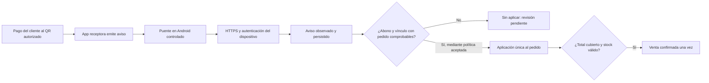

# Revisión y mejora de la propuesta de pagos atribuida a Gemini · 15/11/2026

**Dictamen:** contiene ideas aprovechables, pero no es una solución lista para implementar ni acredita todas las restricciones del proyecto. El puente Android de notificaciones es técnicamente plausible como experimento; no equivale a una API bancaria. El principal defecto de diseño es aplicar un aviso a una venta solo porque coincide el importe. Mercado Pago sí documenta integración Yape y reembolsos, pero su tarifa publicada no cumple cero comisión. Ninguna de esas conclusiones autoriza instalar una app, afiliar cuentas, cobrar ni emitir documentos fiscales.

**Alcance del encargo:** revisar y mejorar los tres textos proporcionados. Los dos primeros son idénticos, SHA256 `f595c0fe5351b73b5b988c89a7e4cb98c21a3b7a99af932a33838bd89cd02179`; el tercero amplía el puente Android, SHA256 `e4f13d809438245f901405c44e8e66eeafdd76f247524ba10563363e365e3d4d`. La mención de una hermana con RUC, exigencias adicionales del profesor o capturas de Mercado Pago son afirmaciones de esos textos, no hechos confirmados por el usuario en esta sesión. No se deduce la intención del profesor ni se promete una calificación.

**Continuidad:** primera revisión documental de estos adjuntos; no es segunda pasada funcional de una etapa. Fuente 08 conservada: SHA256 `c0aa262b2dceba783ffa08e61bcca985857d777f5ef38be7749c4dd99d47e632`. El estado funcional previo se hereda con sus límites; solo se revalidan aquí integridad documental y consistencia de las vistas derivadas. Build y archivos protegidos se identifican en la evidencia enlazada al final.

## Restricciones conservadas

- Proyecto universitario publicado por HTTPS; tres roles actuales y trazabilidad exacta HU/CA/CP.
- Cero comisión de cobro; Yape Empresa/Ayudantes descartado. Costos de cuenta, equipo, datos, alojamiento o automatizadores requieren comprobación aparte.
- Dueño ausente, cajero potencialmente malicioso y atención rápida; no compartir banca, secretos ni cuentas ADMIN por comodidad.
- Transferencias reales pequeñas solo por personas autorizadas, con destinatario e importe acordados. Sandbox no prueba movimiento bancario real.
- No hacer nuevos yapeos para devolver. Una devolución por API sobre el pago original sería otra operación, pero exige proveedor compatible, política aceptada y pruebas; no es una facultad del QR personal.
- Esta revisión no acepta el lector como fuente automática de cobro ni agrega un cuarto rol, integración SUNAT o pantalla nueva al producto.

## Qué conservar y qué corregir

| Afirmación de los textos | Evaluación / mejora |
|---|---|
| QR en pantalla, escaneado directamente desde la billetera | Conservar como objetivo de experiencia. Un QR estático muestra el receptor; escribir «S/ 3» al lado no convierte el QR en una solicitud bancaria con importe y `P-001`. El QR dinámico requiere capacidad real del proveedor, no una imagen generada por nosotros |
| Una venta puede recibir S/ 3 + S/ 7 de dos teléfonos | Conservar relación pedido→varios pagos/aplicaciones. Samsung/iPhone no identifican pagador, comprador ni operación. El receptor Android es un equipo separado de los teléfonos pagadores |
| Dinero en céntimos | Aritmética exacta sí; también sirve `Decimal` con dos decimales. El proyecto ya usa `DecimalField`; no hace falta migrar todo a enteros por seguir el texto. Prohibir `float`, redondeo silencioso y saldos duplicados |
| Android puede escuchar notificaciones | Técnicamente sí, mediante `NotificationListenerService` con acceso concedido. No demuestra compatibilidad con el teléfono, versión de Yape ni campos disponibles del usuario. [A1] |
| Yape notifica nombre, importe y código corto | Yape lo describe oficialmente. Es una señal útil del receptor; no se declara falsa por definición. La fuente no ofrece un esquema estable para automatización, una referencia universal ni el texto literal de Gemini. [Y1] |
| Un correo avisa de cada recepción S/ 3 o S/ 7 | No acreditado. La ayuda encontrada documenta correos por envíos, con umbrales configurables; no equivale a recibos de todos los abonos. [Y2] |
| HMAC demuestra que pagó el cliente | Incorrecto: autentica el mensaje respecto de quienes tienen la clave del puente. No es firma del banco, no prueba la corrección del parser ni liga el aviso al pedido. [A4] |
| Marcar pagado el subcobro activo que coincida con el importe | Rechazar: permite adjudicar un abono real ajeno o tardío a la venta incorrecta, incluso con firma válida y una sola caja |
| Nombre+importe+código de tres dígitos evita confusiones | Son datos de cotejo, no identidad bancaria única. Un código de tres dígitos tiene a lo sumo mil valores; un UUID creado por el puente tampoco transforma dos avisos en operaciones bancarias distintas |
| Confirmación garantizada en 1–2 segundos, sin colas | Sin evidencia. Medir espera bancaria, llegada del aviso, transporte, servidor, render y acción humana por separado; ninguna interfaz evita toda cola. Yape advierte que operaciones con otras entidades pueden tardar minutos. [Y3] |
| Mercado Pago Yape con celular/código sin redirección | Respaldado por Checkout API. Es otro flujo, no el QR estático de la cuenta. No mezclar API Payments y Orders ni pedir al cajero clave de acceso Yape. Un código de aprobación del comprador es efímero y no se registra en logs. [M1,M2] |
| Mercado Pago cobra ~3,99 % sin cargo fijo | Contradice la tarifa pública consultada: Checkout publica 3,49 % + S/ 1 al instante o 3,29 % + S/ 1 a 14 días. No se verificó una tarifa distinta para esta cuenta. No cumple cero comisión. [M3] |
| Todo DNI habilita producción inmediatamente en 2 minutos | No verificado. Abrir cuenta, validar identidad, obtener credenciales y habilitar el producto concreto son pasos distintos. No prometer producción sin comprobar requisitos actuales de esa cuenta |
| Mercado Pago puede reembolsar Yape por API | Sí: la guía Yape de Orders remite expresamente al reembolso de una orden acreditada; una orden manual todavía no procesada puede cancelarse. No es solo inferencia desde un endpoint genérico. No demuestra regreso instantáneo al mismo teléfono ni prueba que la cuenta del proyecto tenga la capacidad. [M1] |
| Usar Mercado Pago para devolver un pago recibido en Yape personal | No: un endpoint de devolución se vincula a un pago procesado por ese proveedor. No devuelve un abono externo que Mercado Pago nunca cobró |
| IzipayYA/DNI/QR siempre 0 % | No generalizar información histórica. Las condiciones actuales consultadas del QR Izipay dentro de App Negocios publican 3,44 % + IGV; QR Plin es un producto distinto. No se ha comprobado alta actual ni modalidad gratis para este caso. [I1] |
| Openpay/Izipay/Taypi sandbox demuestra QR real gratis | Un sandbox puede ayudar a probar código; no demuestra elegibilidad en producción, recepción real, tarifa, QR interoperable ni reembolso real. No se verificaron aquí esas altas o promesas de límites diarios |
| El RUC de una familiar resuelve el proyecto | No es un dato confirmado ni permiso para usar su identidad, cuenta o actividad. No recomendar abrir productos a nombre de terceros para una demo. Tampoco sostener que cada abono es automáticamente una venta gravada: la calificación depende de la operación real y del régimen |
| Al cobrar se emite automáticamente boleta SUNAT y al cancelar nota de crédito | No existe esa integración demostrada. Un pago no habilita al emisor fiscal ni vuelve fiscal una constancia interna. La emisión electrónica tiene requisitos propios. [S1] |
| Identificación del comprador solo si supera S/ 700 | Incompleto: la orientación SUNAT también contempla solicitud del adquirente y otros supuestos. No convertir un umbral fiscal en regla universal para crear clientes o almacenar a todo pagador. [S2] |
| Firma/clave de supervisor y logs inmutables eliminan el robo | Controles útiles, no garantía. Una clave compartida no da responsabilidad individual; un permiso delegado no implica crear nuevo rol. Insert-only limita UPDATE/DELETE del usuario de aplicación, pero no blinda contra DBA, llave robada o eventos falsos |

## Versión mejorada: prueba de viabilidad del puente, sin acoplarlo al cobro

**Estado de la propuesta `PROP-PAY-OBS-01`: REVISADA, NO ACEPTADA PARA IMPLEMENTACIÓN NI COMO FUENTE FINAL DE PAGO.** El usuario autorizó revisar la opción; no se interpreta como aceptación tácita de sus riesgos o cambios de alcance. El siguiente paso útil sería una prueba acotada en un receptor Android real, si se decide realizarla. No construir primero todo el módulo móvil o contratar servicios de automatización.

### 1. Separar la confianza del cajero y la del dispositivo

El teléfono receptor debe estar bajo custodia autorizada, con la app oficial y sin acceso del cajero a banca, configuración del receptor, claves del puente o instalación de apps. El puente no usa accesibilidad para operar banca, no captura pantallas y no hace transferencias. Filtra por paquete/UID observados por Android y verifica la aplicación instalada y su firma según la versión; no confía en un campo JSON `billetera=YAPE` que cualquiera pueda escribir. Controlar el dispositivo reduce riesgos, pero no acredita por sí solo integridad del sistema operativo o del abono. [A1,A2]

**No hace falta dejar la app bancaria abierta para considerar la investigación.** Debe probarse qué notificaciones llegan con app y teléfono bloqueados. Si la solución necesita entregar una sesión bancaria al cajero o evadir protecciones de Android, no satisface la necesidad. El dispositivo requiere mantenimiento ocasional, pero no aprobación del dueño por cada venta; su disponibilidad tampoco está demostrada.

### 2. Registrar un aviso antes de atribuir dinero

Flujo propuesto de investigación:

Es diseño propuesto, no pantalla ni estados aceptados de producto. La bifurcación de comprobación no se implementa devolviendo `true` cuando importe/nombre/código coinciden. Sin una referencia fiable o procedimiento aceptado que resuelva el vínculo, el experimento termina en aviso observado; no entrega mercancía ni descuenta stock.

Guardar lo mínimo para investigar: identidad del dispositivo y receptor configurados, app/versión, clave de notificación, versión del evento, tiempo de publicación/observación/recepción, importe y moneda si están presentes, campos de cotejo realmente disponibles y resultado de interpretación. La clave de notificación es del registro Android, no un ID bancario. El receptor configurado no debe presentarse como dato certificado por el banco. No guardar todos los mensajes/notificaciones del teléfono, claves, códigos de aprobación, tokens o datos personales completos por defecto.

### 3. Entrega segura y recuperación

HTTPS más HMAC por dispositivo o firma con clave protegida, verificando cuerpo original, identidad, versión y repetición. La clave jamás se distribuye al navegador del cajero. Persistir evento antes del ACK; reintentar con el mismo ID local tras fallos de red; conservar revisiones de una notificación. El servidor procesa el mismo evento sin duplicar su efecto, pero no confunde deduplicación de transporte con deduplicación de pagos.

Detectar revocación de permisos, desconexión del listener y falta de actualización del dispositivo; ninguna ausencia de aviso prueba que no hubo abono. Tras reconectar no asumir que se recuperaron todos los eventos perdidos. Android 15 puede ocultar contenido sensible de notificaciones a ciertos listeners: debe probarse si afecta a este caso concreto, sin intentar eludir esa protección. [A1,A3]

### 4. Evitar asignación por coincidencia

Contraejemplo reproducible por razonamiento, **no prueba ejecutada de la aplicación**:

1. Pedido A solicita S/ 3; el cliente paga y se retrasa su notificación.
2. A abandona; se prepara Pedido B, también por S/ 3.
3. Llega el aviso verdadero de A firmado por el puente.
4. El algoritmo de Gemini busca el cobro activo de 300 céntimos, encuentra B y lo marca pagado.

No hubo falsificación del banco ni ruptura de HMAC; aun así, B recibe mercancía con dinero de A. Tener una sola caja o un solo cobro activo reduce simultaneidad, pero no elimina ese caso ni abonos ajenos al negocio. No resolverlo cobrando céntimos adicionales al cliente para fabricar un identificador.

Una mejora candidata para el ensayo es pedir el código corto al pagador antes de mostrar candidatos al cajero y cotejarlo con importe, hora y datos disponibles del receptor. Debe quedar un único candidato no utilizado y sin conflicto; de lo contrario, no aplicar automáticamente. Esto reduce errores frente a buscar solo por monto, pero requiere probar colisiones, intentos de adivinación, pagos ajenos y avisos tardíos. El código no reemplaza un ID bancario. Cualquier límite de intentos, plazo o excepción necesita criterios y casos aceptados antes de incorporarlo al producto; no se añade una validación oculta.

### 5. Mantener el modelo monetario, adaptado al proyecto

Separar pedido/borrador, intento de cobro, aviso observado, abono comprobado, aplicación y reintegro. La `Sale` actual representa una venta confirmada; no convertirla silenciosamente en venta pendiente con efectos sobre caja/stock. Proponer migración y compatibilidad con ventas históricas solo al aceptar el diseño.

- Un pedido puede recibir N aplicaciones. S/ 3 + S/ 7 de distintos pagadores pueden completar S/ 10 sin que esos pagadores deban ser el comprador fiscal.
- Guardar importe exacto, moneda, receptor, origen de comprobación, responsable y referencias disponibles. Si existe ID externo de operación, su unicidad se define por proveedor/cuenta/entorno; un código de tres dígitos no ocupa ese lugar.
- Los totales pagados se derivan de aplicaciones válidas, o se mantienen transaccionalmente con reconciliación; no son dos campos editables que puedan discrepar.
- Para mixto: efectivo aplicado + digital aplicado = total; vuelto = efectivo entregado − efectivo aplicado. Un exceso digital no se convierte automáticamente en salida de caja.
- La aplicación de dinero y confirmación de venta necesitan control de concurrencia e idempotencia. Si el stock/precio cambia tras un abono, conservar dinero sin aplicar y resolverlo; un rollback de Django no deshace la transferencia bancaria.
- Un reintegro tiene su propio importe y estado, incluso parcial o pendiente. Nunca excede lo realmente recibido y adeudado ni reabre/cambia un cierre histórico. Reembolso digital no resta efectivo de la gaveta; devolución física en efectivo sí necesita un movimiento explícito, cuando su política esté aceptada.

### 6. Permisos y atención rápida

Reutilizar los tres roles con permisos precisos, pendientes de refinamiento, en lugar de agregar un supervisor omnipotente. Separar solicitud, aprobación y ejecución del reintegro. Una autorización sensible debe identificar actor real y quedar limitada a operación/importe/receptor/versiones; no desbloquear globalmente la caja mediante una contraseña compartida. No exigir al dueño por cada cobro.

Para rapidez, el sistema podría reducir digitación y actualizar una vista con el estado recuperado del servidor. No es obligatorio añadir Socket.io/Pusher: son decisiones de arquitectura sujetas al alojamiento y carga, no una exigencia de la propuesta. No exhibir nombres/notificaciones de todos los clientes al cajero para que pueda apropiarse de un abono ajeno. Un aviso pendiente o error no debe dar apariencia de dinero confirmado.

### 7. Pruebas que decidirían si avanzar

| Grupo | Casos mínimos / resultado esperado |
|---|---|
| Viabilidad del receptor | Modelo/Android/app/versiones, permisos, pantalla bloqueada, app cerrada, reinicio, batería y cambio de red; documentar campos presentes y ausentes sin formato supuesto |
| Fuente | App ajena con título Yape, paquete/instalación no autorizados, dispositivo revocado, firma inválida; no producir aplicación monetaria |
| Entrega | Evento repetido, notificación actualizada/agrupada, ACK perdido, retransmisión y fuera de orden; conservar aviso sin duplicar dinero |
| Asociación | Dos clientes de igual importe, pagador tercero, código corto repetido, pago ajeno, A tardío tras cancelar y B activo; no autoasignación errónea |
| Interrupciones | Permiso retirado, listener desconectado, red caída, servidor reiniciado, contenido oculto; mostrar incertidumbre y recuperar, sin afirmar no pago |
| Dinero | 3 + 7, dos abonos del mismo monto, mixto, insuficiente/exceso, cancelación después del primer abono, stock/precio cambiados; persistir cada hecho |
| Reintegro | Solicitud versus salida real; parcial/duplicado/concurrente, proveedor equivocado y timeout; no nuevo yapeo ni devolución marcada por simple anulación |
| Rapidez | Medir p50/p95 y casos perdidos con una muestra declarada; separar tiempo externo y propio. No fijar 1 segundo como resultado observado |

Todos estos casos están **DISEÑADOS / NO EJECUTADOS**. No son CP aceptados añadidos a 08. Primero pruebas aisladas con eventos ficticios; después, si se acepta el experimento y hay dispositivo/cuenta adecuados, ensayo humano pequeño con movimientos receptores como contraste. Una prueba satisfactoria de transporte no valida automáticamente pago ni asociación. Los intentos de abuso no se realizan con dinero real.

## Recomendación al proyecto

**Conservar QR directo, varios abonos y separación del dinero. Evaluar el puente en un experimento acotado, sin activar autoconfirmación. No combinar ahora con Mercado Pago:** encarece el proyecto, agrega un segundo flujo y contradice cero comisión. La API oficial de Mercado Pago existe, pero queda como alternativa únicamente si el usuario cambia esa restricción. Tampoco introducir emisión fiscal o cuentas de familiares para aparentar que el recorrido está completo.

Si el experimento no obtiene datos suficientes para ligar inequívocamente dinero y pedido, hay que aceptar un cotejo humano definido o conseguir un canal independiente compatible. No se resuelve cambiando el nombre de «aviso» a «pago confirmado». Esta conclusión mantiene abierto `PAY-CANAL-01-SIN-COMISION` y no bloquea continuar Etapa 02.

## Fuentes primarias y límites de la consulta

- **Y1:** [Yape: verificar recepción y código de seguridad](https://www.yape.com.pe/preguntas-frecuentes/yape-negocios/como-puedo-verificar-que-he-recibido-un-pago-por-yape).
- **Y2:** [Yape: avisos por correo de envíos](https://www.yape.com.pe/preguntas-frecuentes/creditos-yape/como-recibo-un-correo-de-aviso-cada-vez-que-envie-un-yapeo).
- **Y3:** [Yape: saldo y movimientos de otras entidades](https://www.yape.com.pe/preguntas-frecuentes/in-app/que-hago-si-mi-saldo-no-coincide-despues-de-enviar-o-recibir-un-yapeo).
- **A1:** [Android NotificationListenerService](https://developer.android.com/reference/android/service/notification/NotificationListenerService).
- **A2:** [Android StatusBarNotification](https://developer.android.com/reference/android/service/notification/StatusBarNotification).
- **A3:** [Android 15: cambios de comportamiento](https://developer.android.com/about/versions/15/behavior-changes-all).
- **A4:** [RFC 2104: HMAC](https://www.rfc-editor.org/rfc/rfc2104).
- **M1:** [Mercado Pago: Yape vía Orders](https://www.mercadopago.com.pe/developers/es/docs/checkout-api-orders/payment-integration/websites/yape?scope=prod).
- **M2:** [Mercado Pago: Yape vía Payments](https://www.mercadopago.com.pe/developers/es/docs/checkout-api-payments/integration-configuration/yape).
- **M3:** [Mercado Pago Perú: tarifa Checkout](https://www.mercadopago.com.pe/herramientas-para-vender/check-out).
- **I1:** [Interbank: condiciones QR Izipay App Negocios](https://interbank.pe/terminos-y-condiciones-para-el-uso-de-codigo-qr-link-de-pago-y-plataforma-de-pago-en-tiempo-real-de-izipay1).
- **S1:** [SUNAT: requisitos y documentos SEE-SOL](https://cpe.sunat.gob.pe/sistema_emision/see_sol).
- **S2:** [SUNAT: boleta electrónica e identificación](https://cpe.sunat.gob.pe/tipos_de_comprobantes/boleta).

Fuentes consultadas 15/11/2026. No se validó una cuenta real, afiliación, términos del automatizador, capacidad del teléfono o relación contractual con proveedores. No se adoptan plazos/límites bancarios universales ni se reintroducen obligaciones de retención de seguridad ajenas al alcance. Al final, una consulta web adicional falló por autenticación del conector; las conclusiones anteriores proceden de fuentes ya obtenidas y la elegibilidad de cuenta sigue sin verificar.

**Entrega:** revisión técnica y propuesta mejorada, sin código de producto, pruebas funcionales ni transacciones. [Evidencia e integridad documental](evidencias/REVISION-GEMINI-20261115/validacion.json). **Cursor funcional conservado:** `02-DEMO-TRAZABILIDAD-01`. **Investigación propuesta:** `PROP-PAY-OBS-01`, sin autorización implícita para cambiar 08 o habilitar dinero real.
