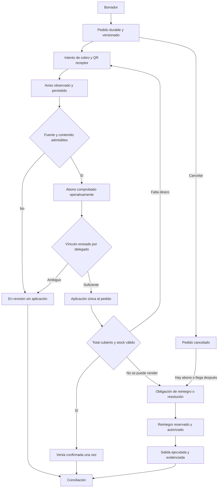

# Dictamen independiente de pagos · 15/11/2026 · America/Lima

**Decisión recomendada: avanzar con un cobro QR directo a la cuenta Yape autorizada, un registro monetario independiente y comprobación asistida desde el receptor. Ensayar primero el puente Android; no habilitar todavía el cobro real del producto.** Para la primera demostración recomiendo que una persona delegada distinta del cajero valide la asociación entre el abono y el pedido. El dueño no interviene en cada operación. La existencia del abono procede del canal receptor ensayado; la segunda persona no puede inventarlo marcando una casilla.

Esta es una **RECOMENDACIÓN PROPUESTA**, no aceptación de requisitos ni autorización de implementación. No se propone Mercado Pago como parte del recorrido: su modalidad examinada tiene comisión y no utiliza el QR directo requerido. Tampoco se incorpora Yape Empresa/Ayudantes, ya descartado. La recepción sin comisión no hace gratuitos el teléfono, datos, trabajo humano, alojamiento ni mantenimiento.

Para el dueño: el sistema debe reconocer cuánto dinero recibió el negocio, a quién pertenece y cuánto queda por resolver, aunque falle una pantalla. El riesgo más importante de Gemini no es solo una captura falsa: es entregar productos de la compra B usando un abono verdadero de la compra A. Una firma del teléfono no corrige esa confusión.

**Resultado actual: viable como rumbo de construcción y ensayo condicionado; todavía no demostrado como canal de cobro.** La alternativa principal incluye operación humana breve, riesgo residual explícito y conciliación. Si el puente no resulta permitido o no ofrece evidencia suficiente, el reemplazo mínimo es un cotejo directo por una persona con acceso legítimo propio al receptor; su disponibilidad no se presume. Si tampoco existe ese acceso, las capacidades verificadas no satisfacen simultáneamente las restricciones y el dinero real debe permanecer deshabilitado.

**1. Alcance, autoridad y calidad de la evidencia**

Se leyeron los siete documentos iniciales indicados, se contrastaron los tramos aplicables de 08, 02, 16 y las vistas 07/09/03, y se inspeccionaron ventas, caja, inventario, identidad, permisos, rutas, plantillas y pruebas existentes de `C:/Users/walte/OneDrive/Imágenes/planificacion_limpia/r1-pmv/`. Se localizaron y leyeron los originales de Gemini mediante el manifiesto anterior; no se dependió únicamente de su resumen.

| Etiqueta de evidencia | Significado en este dictamen |
|---|---|
| VERIFICADO DOCUMENTALMENTE — VD | Leído en fuente oficial o en documento/código local identificado; no implica ejecución |
| PROBADO — PR | Ejecutado por esta revisión, únicamente en el alcance concreto declarado |
| INFERIDO — IN | Conclusión de arquitectura o riesgo derivada de hechos; no observación bancaria |
| PENDIENTE DE DISPOSITIVO O CUENTA — PD | Necesita observar el equipo, la modalidad, los movimientos o la habilitación de la cuenta; incluye aclaración del proveedor cuando corresponda |
| DECISIÓN DE NEGOCIO — DN | Elección de operación, riesgo, permisos, medio o presupuesto que debe registrarse como aceptada antes de aplicarse |

Los estados de entrega son independientes de esas etiquetas: **PROPUESTO / ACEPTADO / IMPLEMENTADO / PROBADO**. Una funcionalidad puede estar aceptada y no implementada; una capacidad documentada por un proveedor puede no estar disponible para esta cuenta. Todas las políticas, facultades, estados nuevos y tareas de este informe están **PROPUESTOS**, salvo restricciones ya aceptadas y hechos expresamente declarados por el usuario.

**Línea base comprobada.** 08 SHA256 `c0aa262b2dceba783ffa08e61bcca985857d777f5ef38be7749c4dd99d47e632`. Las tres vistas declaran esa misma huella; no se regeneraron. Producto: HEAD `7816d3328115cf5aa5bcdd0985fffd795b3ae084`, con 207 entradas en `git status --porcelain` preexistentes; el commit solo no identifica el producto revisado. Manifiesto propio de 232 archivos de producto seleccionados: SHA256 `6fec70fa58a357f7b679656d29ec722daff62b495da075c995869c3db0214fea`. El manifiesto declara sus exclusiones; no es intercambiable con los hashes de builds anteriores. Dependencias declaradas incluyen Django 5.2.18 y Python objetivo 3.12; el Python usado para las comprobaciones aisladas fue 3.12.10.

Originales Gemini: dos copias de 9.653 bytes con SHA256 `f595c0fe5351b73b5b988c89a7e4cb98c21a3b7a99af932a33838bd89cd02179`, y ampliación de 7.838 bytes con SHA256 `e4f13d809438245f901405c44e8e66eeafdd76f247524ba10563363e365e3d4d`. Coinciden con las huellas heredadas. No había una versión previa de este dictamen al crear el archivo. Los informes anteriores permanecen conservados.

Evidencia propia: [inspección de código](C:/Users/walte/OneDrive/Imágenes/planificacion_limpia/auditoria_por_etapas/resultados/evidencias/DICTAMEN-ASTRA-20261115/codigo.md), [contraste de planificación](C:/Users/walte/OneDrive/Imágenes/planificacion_limpia/auditoria_por_etapas/resultados/evidencias/DICTAMEN-ASTRA-20261115/planificacion.md), [manifiesto inicial](C:/Users/walte/OneDrive/Imágenes/planificacion_limpia/auditoria_por_etapas/resultados/evidencias/DICTAMEN-ASTRA-20261115/antes.json), [originales identificados](C:/Users/walte/OneDrive/Imágenes/planificacion_limpia/auditoria_por_etapas/resultados/evidencias/DICTAMEN-ASTRA-20261115/adjuntos.json) y [validación final](C:/Users/walte/OneDrive/Imágenes/planificacion_limpia/auditoria_por_etapas/resultados/evidencias/DICTAMEN-ASTRA-20261115/validacion.json).

No se ejecutó Django, no se abrió una base operativa mediante ORM/SQL, no se migró, instaló una app, cambió una cuenta, transfirió dinero ni publicó un servicio. La base SQLite principal solo se leyó como bytes para su huella. Los resultados históricos 652/652, Chrome, PostgreSQL y 01-K son **evidencia heredada**, no pruebas repetidas aquí ni aprobación de Yape. Se ejecutaron seis modelos aislados descritos en el apartado 10; no prueban el producto.

**Continuidad intacta:** Etapa 01 = ingreso, bloqueo y acceso según rol; Etapa 02 = sesión y personal. Se conserva `02-DEMO-TRAZABILIDAD-01`. No se modifica ESTADO_GENERAL ni se abre/cierra ninguna etapa mediante este dictamen.

**Datos aportados durante esta revisión.** El usuario utilizará su Galaxy A52s 5G personal, Android 14, One UI 6.1; dispone de una cuenta Yape con DNI y otra con BCP. Puede participar una persona delegada. Aceptó **evaluar** efectivo con controles y delegación, no ejecutar devoluciones ni aceptar topes. Son declaraciones del usuario, no inspecciones del dispositivo. Falta seleccionar cuál cuenta está activa y será receptora, verificar el QR y registrar la autorización de su titular para el ensayo. No es necesario abrir otra cuenta ni usar identidades familiares. La titularidad debe describirse como cuenta de la persona autorizada para la demostración, sin fingir una persona jurídica inexistente.

**2. Afirmaciones de Gemini y de las revisiones anteriores**

| Origen y afirmación | Evaluación independiente | Evidencia y consecuencia |
|---|---|---|
| Gemini: la arquitectura anterior era impecable y debía conservarse al 100 % | **Incorrecta como conclusión de auditoría** | IN. Contiene supuestos de pasarela, supervisor, fiscalidad y devoluciones no aceptados. Se conserva solo lo que supera este contraste |
| Gemini: conoce qué quiso decir el profesor y la solución asegura la máxima nota | **No sustentada** | VD de los adjuntos; no hay rúbrica que demuestre esas intenciones. No se usa para decidir |
| QR directo del receptor sirve para recibir | **Correcta, incompleta para cobrar dentro de Django** | VD [Y-QR]. El QR no acredita recepción, ni lleva necesariamente importe u orden |
| Poner S/ 3 y luego S/ 7 junto al QR genera cobros bancarios identificados P-001/P-002 | **Incorrecta** | IN. Esos identificadores son nuestros; un QR estático no los transmite al banco. No fabricar un QR dinámico sin soporte documentado |
| Una compra puede completarse con varios abonos | **Correcta como diseño** | VD de HU-VEN-10; IN de modelo. No existe aún en producto; teléfono Samsung/iPhone no identifica al dueño del dinero |
| Hace falta reemplazar Decimal por céntimos enteros | **Incorrecta como necesidad** | VD de código. Ambos son válidos con precisión exacta; conservar Decimal y excluir float/NaN/redondeo silencioso |
| Android permite observar notificaciones con NotificationListenerService | **Correcta técnicamente** | VD [A-LISTENER]; PD del A52s concreto. No significa que todo contenido esté disponible ni que Yape permita toda automatización |
| El texto, paquete y campos exactos mostrados por Gemini son contrato estable | **Pendiente / incompleta** | PD. No se presume el literal ni la huella del firmante. Se mide en la app instalada; desconocidos se rechazan como formato no soportado |
| Nombre, importe y código corto figuran en el aviso receptor | **Correcta documentalmente** | VD [Y-AVISO]; no demuestra unicidad, referencia bancaria ni entrega completa al listener |
| Todos los abonos llegan por correo instantáneo | **No acreditada** | Los términos distinguen notificaciones por canal y operaciones; no se ensayó buzón, formato ni cobertura. PD; correo no es alternativa seleccionada |
| Una pantalla falsa del cliente no puede crear un abono receptor | **Correcta bajo custodia íntegra; demasiado absoluta en Gemini** | IN. No genera dinero; un dispositivo comprometido, parser defectuoso o app imitadora mal filtrada puede producir evidencia falsa para nuestro sistema |
| HMAC prueba que pagó el cliente | **Incorrecta** | VD de [RFC-HMAC] e IN. Prueba autenticidad/integridad respecto a una clave del puente; no firma bancaria, depósito ni pertenencia a una venta |
| Buscar el subcobro activo por importe resuelve la asociación | **Incorrecta** | PR-M01: A cancelado paga 3; aviso tardío encuentra B activo por 3. La firma puede ser válida y la asignación errónea |
| Nombre+hora+importe+código de tres dígitos bastan siempre | **Incorrecta** | IN y PR-M02. Reduce candidatos, no demuestra unívocamente origen ni intención. Código de tres dígitos: como máximo 1.000 valores |
| UUID local o clave de notificación equivale a ID de pago | **Incorrecta** | VD [A-SBN], PR-M03. Reintento de transporte, notificación y transacción bancaria tienen identidades distintas |
| WebSocket/Pusher garantiza uno o dos segundos y ausencia de colas | **Incorrecta / no medida** | IN. Solo cambia transporte de estado a pantalla; no tiempo bancario, Android, revisión ni arranque del alojamiento |
| Mercado Pago Perú integra Yape sin redirección mediante celular y código de aprobación | **Correcta para la modalidad documentada** | VD [MP-ORDERS] y [MP-PAYMENTS]. Ese flujo no cumple por sí mismo QR directo; el código de aprobación no es el código corto de recepción |
| Mercado Pago cobra aproximadamente 3,99 %, sin cargo fijo | **Incorrecta frente a la tarifa pública consultada** | VD [MP-TARIFA]: 3,49 % + S/ 1 al instante; 3,29 % + S/ 1 a 14 días. No cumple cero comisión; no se afirma tarifa negociada de una cuenta |
| DNI habilita inmediatamente producción en dos minutos | **Pendiente, no demostrada** | Abrir cuenta, validar identidad y habilitar un producto son hechos distintos. No se afiliaron cuentas ni se probaron credenciales |
| Mercado Pago no puede reembolsar Yape | **Incorrecta si alguna revisión lo deduce genéricamente** | VD [MP-ORDERS]: contempla refund de una orden Yape acreditada. No prueba plazo, destino final o habilitación de nuestra cuenta |
| Una API de Mercado Pago devuelve un abono recibido directamente en Yape común | **Incorrecta** | IN del vínculo requerido con la operación procesada por ese proveedor. No combinar canales para aparentar una reversa inexistente |
| izipayYA con DNI, QR Izipay y Plin siempre son 0 % y equivalentes | **Incorrecta como generalización** | VD [IB-PLIN] publica cobro Plin sin comisión; [IB-IZIPAY] publica 3,44 % + IGV para QR Izipay en App Negocios. No demuestra condiciones de cada producto llamado izipayYA |
| Topes diarios/mensuales de Yape, Plin e izipay son intercambiables | **Incorrecta** | Modalidad, entidad, envío y recepción difieren. PD: registrar límites reales de la cuenta elegida; no fijar los ejemplos de Gemini como contrato |
| Sandbox de Openpay/Izipay/Taypi prueba cobro real QR gratis | **Incorrecta** | IN. No demuestra elegibilidad, tarifa ni liquidación. No se invierte más investigación en ellos para esta decisión |
| Usar el RUC/cuenta de una hermana resuelve el proyecto | **Incorrecta para este encargo** | No hay autorización ni necesidad demostrada; se excluye. Tampoco inferir que cada transferencia de prueba sea una venta fiscal |
| Boleta electrónica y nota de crédito se generan automáticamente | **Incorrecta respecto al producto** | VD de código y HU-VEN-02a: constancia interna. Integración SUNAT fuera del cambio autorizado; no se añade |
| Una clave de supervisor y logs append-only eliminan el robo | **Incorrecta** | IN. Clave compartida elimina atribución individual; DBA, dispositivo comprometido, abuso físico y colusión permanecen |
| Decisión anterior: no hay API gratuita/delegación oficial verificada | **Correcta como límite de lo investigado** | No demuestra inexistencia universal. No hay API nueva verificada en este corte |
| Texto anterior: solo una API del proveedor permite cualquier confirmación automática útil | **Demasiado restrictiva si se interpreta literalmente** | IN apoyada por [Y-AVISO]. Una observación auténtica puede servir como evidencia operativa automatizada bajo custodia y política aceptadas; no adquiere garantía bancaria |
| Revisión anterior: pedir código antes de mostrar candidatos ayuda contra apropiación | **Correcta pero insuficiente** | IN. Cajero/cliente coludidos pueden conocer un abono ajeno; un candidato local único no prueba pertenencia. Añadir separación de funciones y manejo de ambigüedad |
| Revisión anterior: avisos, abonos, aplicaciones y reintegros deben separarse | **Correcta, faltaba decisión operativa concreta** | IN. Aquí se define primera operación asistida, evidencia mínima, política candidata, ensayo de salida y secuencia de construcción |
| Planificación actual bastaría con programarla sin ajustes | **Incorrecta** | VD. Persisten contradicciones sobre declaración del vendedor, referencia, caja, descarte, anulación y reclamos tras cierre; apartado 12 |

**Condiciones del proveedor, investigadas expresamente.** La ayuda oficial contempla Yape con DNI y con BCP, y describe obtención del QR para un negocio [Y-CUENTA], [Y-QR]. Esto no acredita automáticamente cuenta empresarial, elegibilidad particular, delegación bancaria o permiso para publicar datos del titular. Los términos oficiales de Yape, cláusula 3.2, mantienen la obligación del usuario de comprobar cargo/depósito aun existiendo avisos; la cláusula 12 protege los contenidos y propiedad intelectual de BCP. Se leyó el HTML público porque el extractor web solo mostraba un iframe; la extracción y su hash constan en [evidencia contractual](C:/Users/walte/OneDrive/Imágenes/planificacion_limpia/auditoria_por_etapas/resultados/evidencias/DICTAMEN-ASTRA-20261115/terminos_fuente.json). **No se encontró permiso expreso para reenviar avisos a un servidor propio ni una prohibición específica inequívoca de este listener pasivo. Su compatibilidad contractual queda pendiente de aclaración del proveedor; ausencia de una cláusula específica no es autorización.** No se extrapolan las prohibiciones del Marketplace a toda recepción de dinero [Y-TERMINOS].

Propuesta de consulta concreta, para que el titular la realice si avanza: lectura local, consentida y filtrada de avisos de recepción mediante API estándar Android; transmisión mínima a servidor propio para registrar ventas; sin operar Yape, extraer claves, accesibilidad, ingeniería inversa ni redistribuir contenidos. Solicitar confirmación de compatibilidad con la modalidad elegida. No se envió ninguna consulta ni mensaje a terceros en esta revisión. Una respuesta negativa descarta el puente; no se eluden protecciones ni se disfraza de integración oficial.

**3. Alternativas pertinentes y elección**

| Criterio | A. QR Yape común + puente ensayado + asociación asistida — principal | B. QR + comprobación humana directa legítima — respaldo | C. Mercado Pago Yape — referencia descartada |
|---|---|---|---|
| Restricciones | Candidata a QR y cero comisión; dueño ausente; necesita prueba y política | Candidata si existe acceso legítimo independiente; no comprobado | Tiene comisión; flujo estudiado celular/OTP, no QR directo |
| Cuenta/equipo | Una cuenta receptora elegida, A52s controlado durante uso, servidor HTTPS | Misma cuenta/QR y persona con acceso propio permitido; no clave compartida | Cuenta habilitada, credenciales del producto, integración y evaluación de tarifa |
| Costos | QR común publicado gratuito [Y-COSTO], [Y-GRATIS]; teléfono/datos/energía/delegado/mantenimiento aparte | Sin comisión de la recepción elegida; costo humano y continuidad operativa | Tarifa [MP-TARIFA], integración y alojamiento; no seleccionada |
| Fuente | App receptora oficial observada; conciliación posterior con movimientos | Movimiento del receptor visto legítimamente; el software registra comprobación humana | Estado consultable del proveedor autenticado, una vez implementado |
| Asociación | Pedido congelado + reclamación del pagador + revisión independiente; ambigüedad se suspende | Referencia/evidencia receptora y reclamación; misma ambigüedad si los datos son pobres | Identificador del pago y orden creados por la integración; aún verificar importes/receptor |
| Abuso del cajero | No crea avisos, no ve bandeja ajena, no autoaprueba vínculo/reintegro | Independencia del verificador esencial; una simple declaración sigue siendo débil | No falsifica estado del proveedor; sí puede abusar de permisos/mercadería |
| Devolución | No reversa original comprobada; efectivo solo si se acepta política del apartado 9 | Igual limitación del canal original | Reembolso documentado de su propia operación; capacidad real pendiente |
| Fallos | Cola durable, suspensión de nuevos QR, pedidos aparcados, conciliación | Ausencia de persona/acceso bloquea digital; efectivo sigue disponible para otros clientes | Consulta de estado/reintentos idempotentes; proveedor también puede fallar |
| Atención | Escaneo y envío + breve revisión; tiempo total por medir | Puede ser más lenta; medir disponibilidad/consulta/cotejo | Tampoco hay garantía de segundos; más pasos para comprador |
| Complejidad | Media/alta: parser Android, custodia, libro monetario y mantenimiento por versión | Menor software del canal; mayor dependencia humana y permisos externos | Media/alta, además no cumple restricciones |
| Riesgo residual | Teléfono/administrador comprometido, colusión, avisos perdidos, atribución engañosa | Error/colusión del verificador; sin evidencia independiente de su declaración | Cuenta comprometida, integración defectuosa, contracargos y abuso interno |

**Elección: A, de forma provisional y asistida.** B es un respaldo operativo sujeto a demostrar acceso permitido; no se presenta como disponible por tener una segunda persona. No usar un cuarto rol ni dar la contraseña Yape al ALMACENERO. Puede revisar la evidencia del puente en nuestro sistema con permiso limitado; eso no le concede acceso a fondos. Para incidencias sin aviso hará falta acceso legítimo a los movimientos, posiblemente del titular en una revisión posterior, sin bloquear toda la atención ni exigirle aprobar ventas normales.

Plin Interbank es un candidato de recepción secundario documentado, no un cuarto medio a implementar ahora: su QR admite pagos desde Yape, exige cuenta en soles afiliada y publica cobro sin comisión [IB-PLIN]. No resuelve por sí solo la asociación, la devolución ni la consulta delegada. No cambiar de cuenta/proveedor antes de ensayar la cuenta ya disponible.

**Incompatibilidades exactas.** Hoy no hay canal ensayado ni política de reintegro aceptada. Con QR estático, información no única, ningún verificador independiente y exigencia de impedir toda apropiación de abonos por cajero/cliente coludidos, faltaría información: ningún algoritmo puede reconstruir la intención que el banco no transmitió. El cambio mínimo propuesto es revisión independiente más aceptación del riesgo residual limitado; el usuario ya confirmó disponibilidad de esa persona, no aprobó todavía sus facultades. Si se exige una vinculación bancaria criptográfica por orden, deberá cambiar el canal y posiblemente comisión/afiliación/flujo; no basta HMAC. Asimismo, prohibir nuevos yapeos y no autorizar ningún otro medio deja imposible ejecutar un reintegro con las capacidades comprobadas de Yape común. El cambio mínimo recomendado es aceptar efectivo controlado para casos elegibles, todavía en evaluación.

**4. Cadena de confianza: siete comprobaciones diferentes**

| Capa | Qué se exige y qué demuestra | Límite / evidencia |
|---|---|---|
| a. Aplicación originadora | Observar metadatos entregados por Android: paquete propietario, UID, usuario/perfil y paquete que publica; comprobar certificado del paquete instalado contra procedencia oficial. Tratar delegación de notificaciones explícitamente; no basta nombre/icono/texto | VD: Android distingue `getPackageName()` de `getOpPkg()` y su clave identifica un registro de notificación [A-SBN]. Certificado verificable con PackageManager [A-PKG]. PD: identidad/firmante reales, sin hardcodear el ejemplo de Gemini |
| b. Teléfono receptor | Equipo actualizado, bloqueo, custodia fuera del cajero, sin root ni depuración operativa, instalación controlada, versión de app/puente registrada, claves protegidas y revocables | IN de control. Keystore reduce extracción pero un proceso comprometido puede usar la clave [A-KEY]. No acredita integridad absoluta del OS ni cuenta vinculada |
| c. Transporte | HTTPS validado, autenticación individual de dispositivo, firma del cuerpo/identidad/versión/ID, reintento con mismo ID, persistencia antes de ACK, revocación y límites | IN de diseño; HMAC autentica al puente, no al banco [RFC-HMAC]. Clave solo dispositivo/servidor, nunca navegador ni cajero |
| d. Abono | Aviso con semántica de recepción, PEN, importe válido y modalidad ensayada, identidad de cuenta configurada y controlada; contrastar contra movimientos en piloto y conciliación | VD de utilidad del aviso [Y-AVISO]; IN de aceptación operativa. No prueba liquidación irrevocable ni integridad del banco; destinatario configurado no equivale a destinatario firmado por banco |
| e. Vínculo con compra | Intento de un pedido/version/receptor, reclamación del pagador recogida antes de revelar candidatos, cotejo independiente y evidencia suficiente | IN/DN. No hay ID pedido dentro del QR común. Coincidencias son indicios; conflicto/ambigüedad bloquean aplicación, no se eligen arbitrariamente |
| f. Uso único | Registro canónico del abono, saldo disponible, reserva/aplicación y reintegro bajo transacción/locks; identidad externa única si existe | IN. Una restricción de UUID no deduplica el banco. Sin ID externo, conservar identidad interna explícita y resolver avisos dudosos sin crear dinero nuevo |
| g. Vida posterior | Cancelación, retorno de mercadería, deuda y salida de dinero separados; conciliación de banco/libro/caja | IN/DN. No borrar hechos ni reescribir cierres; una devolución externa incierta continúa reservada hasta saber resultado |

En el A52s personal, la custodia propuesta es temporal para el ensayo: mantenerlo bloqueado y bajo responsabilidad del titular, sin prestarlo al cajero ni dejar sesión bancaria abierta. El listener filtra localmente y descarta avisos ajenos; no envía correo, SMS, claves de aprobación o todas las notificaciones del teléfono. Los abonos personales a la misma cuenta son ruido real que debe conservarse como **sin atribuir al negocio**, no ingresos comerciales. Para operación habitual, un receptor dedicado o una custodia equivalente sería más mantenible; no se autoriza comprar equipo.

Android 14 declarado no permite dar por comprobado el comportamiento del listener. Android 15 introduce ocultación de OTP a listeners no confiables; no se afirma que eso afecte hoy a este teléfono, pero una actualización exige reensayo, sin desactivar protecciones [A-15]. El código corto de recepción de tres dígitos es dato de cotejo, distinto del OTP de aprobación de compras; no se capturan secretos para suplir campos faltantes.

**5. Flujo recomendado, estado y atención de incertidumbre — PROPUESTO**

1. ADMINISTRADOR configura una versión del receptor y QR verificados. La pantalla muestra el titular real esperado y el importe. VENDEDOR no puede subir otro QR, cambiar destino ni editar evidencia. Custodia física y verificación del nombre mostrado por la billetera del cliente complementan el control servidor: un empleado puede superponer una imagen o pegar otro QR si controla físicamente el puesto.
2. Se prepara el borrador. Al comenzar cobro se crea un **pedido durable** con copia de líneas/precios, versión y total aceptado, más un **intento** por el importe que se pretende completar. El precio se congela para ese pedido bajo la política propuesta; las existencias se revalidan al confirmar. No se cambia la regla de stock silenciosamente.
3. Cliente escanea el QR receptor desde su billetera y comprueba destinatario. Puede haber varios pagadores. Se identifica cada aportación esperada sin exigir que pagador y comprador sean la misma persona ni recopilar su DNI por defecto.
4. El puente guarda localmente un aviso y lo transmite. Servidor confirma recepción solo tras persistir. Registrar aviso no confirma venta, no descuenta stock y no autoriza entrega.
5. Se recoge la reclamación del pagador: pedido que quiere pagar, importe enviado, momento aproximado, nombre que aparece y código corto si realmente existe. La persona delegada puede recogerla directamente; no se muestra al cajero una lista completa de nombres/códigos de abonos libres. El dato del cliente no crea evidencia de recepción.
6. Servidor busca candidatos conservando cuenta, moneda, modalidad, versiones, revisiones, abonos ya utilizados y pedidos cancelados. La persona delegada revisa el pedido y la reclamación del pagador frente al evento receptor. Para el primer piloto, esta revisión se hace en **cada aplicación digital**; cualquier reducción futura sería otro cambio de política, no una mejora técnica silenciosa.
7. Solo se vincula cuando hay un abono admisible y una asociación operativa sustentada. Autorización ligada a pedido/version/abono/importe/receptor, uso único y actor distinto del cajero. Si el conjunto admite más de una explicación razonable, queda en revisión. Una segunda firma no convierte la ambigüedad en certeza.
8. Al completar el total, la confirmación transaccional crea una única Sale, aplicaciones definitivas, efecto neto de caja y descuento FEFO. Se recupera por clave idempotente ante respuesta perdida. Entrega de productos y constancia interna solo con resultado persistido confirmado.
9. Al finalizar turno se cotejan aplicaciones, abonos sin aplicar, reintegros y movimientos del receptor; el cierre físico considera únicamente movimientos de efectivo. La revisión periódica del titular no es aprobación por cada cobro.

**Qué elimina el cotejo y qué no.** El importe descarta cantidades distintas; receptor/moneda descartan otras cuentas/monedas; hora ayuda a acotar investigación, pero la hora de publicación no es necesariamente hora bancaria. Nombre distingue algunos pagadores, no homónimos ni terceros. Código corto reduce coincidencias accidentales, no identifica globalmente ni sirve como contraseña. Recoger la reclamación antes de revelar datos dificulta apropiación oportunista; no vence conocimiento previo ni colusión. El identificador del intento identifica nuestra solicitud, no el envío bancario. La persona independiente aporta observación del contexto y dificulta fraude del cajero con cliente; si también colude, ese control falla. Un pago remoto de tercero con identificación insuficiente debe esperar cotejo adicional, aunque sea legítimo.

**Un único candidato no basta por definición.** Puede ser el abono de alguien que todavía no reclamó o un pago personal. No se exige un identificador bancario inexistente, pero tampoco se reemplaza por una coincidencia estadística presentada como garantía. El responsable debe aceptar expresamente un estándar de comprobación operativa para este canal. Si exige prueba inequívoca emitida por el proveedor para cada pedido, este canal no la ha demostrado y no se habilita bajo esa exigencia.

**Cuando hay incertidumbre:** el cajero ve el pedido, total, efectivo aplicado, digital aplicado, saldo y estado pendiente, sin datos de otros clientes. Puede consultar estado, aparcar el pedido, solicitar revisión o cancelar lo aún no consumado; no puede marcar recibido ni reasignar un abono. Se entrega una constancia interna de incidencia con código del pedido, importes reconocidos y lo pendiente, sin afirmar pago fallido ni devolución. No entregar mercancía ni pedir otro yapeo mientras el resultado previo sea desconocido.

Aparcar permite atender otra compra conservando el pedido con deuda/evidencia; exige cambiar RN-30, hoy no existe. Los productos físicos se mantienen identificados y separados del pedido nuevo. Propuesta inicial: no aceptar efectivo adicional de una compra con transferencia incierta; sí seguir atendiendo otros pedidos en efectivo. Permitir reemplazar un pago incierto por efectivo requeriría otra regla explícita de depósito duplicado/reintegro y consentimiento informado; no se presupone.

Teléfono/listener sin salud reciente o servidor no disponible: no iniciar nuevos intentos QR y mostrar pausa digital. El cliente podría usar un QR impreso antiguo de todas formas; cualquier ingreso se procesa luego como pendiente. Un heartbeat verde demuestra enlace, no que Android haya emitido todos los avisos. Al volver la red no se presume recuperación completa. Sin aviso pero con abono real, se recupera mediante movimientos del receptor por acceso legítimo y se registra su procedencia; nunca se declara que no pagó porque falta el aviso.

Un aviso tardío de A cancelado queda ligado a su evidencia/reclamación pendiente, aunque B esté activo con igual importe. No se descarta por superar una ventana de tiempo ni se convierte en pago de B. Si no puede ligarse a A, queda sin atribuir. Envío a destinatario equivocado: no existe ingreso del negocio, no se acredita ni se reembolsa con fondos del negocio; conservar incidencia y permitir que el pagador gestione su error. No exigir otro envío mientras el resultado al receptor correcto siga incierto.

**6. Modelo monetario y estados — PROPUESTO / INFERIDO**

No modificar silenciosamente `Sale`: actualmente representa una venta confirmada. Se recomienda un módulo de pagos dentro del monolito Django, sin microservicios ni pasarela inventada. Entidades conceptuales, todavía no tablas implementadas:

| Entidad | Significado y estados propuestos | Regla de integridad |
|---|---|---|
| Borrador | Carrito editable, sin efectos monetarios | Puede descartarse solo mientras no contiene compromisos monetarios; su conversión deja un pedido durable |
| Pedido | Copia versionada del acuerdo: PREPARADO, COBRO_ABIERTO, PARCIAL, CUBIERTO_PENDIENTE_CONFIRMACION, EN_REVISION, CANCELADO, CONVERTIDO_EN_VENTA | Persistente fuera de sesión; líneas, total y receptor aprobados no se alteran después del dinero sin nueva versión y resolución explícita |
| Intento de cobro | Solicitud para aportar cierto importe: ABIERTO, SUSPENDIDO, CANCELADO, RESUELTO | No demuestra dinero. Cancelarlo no invalida una transferencia real ni borra el pedido |
| Aviso recibido | Hecho observado: RECIBIDO, INTERPRETABLE, NO_SOPORTADO, REVISION, RELACIONADO | Inmutable con revisiones anexas. Varias observaciones pueden describir un abono; una agrupación puede describir varios y no debe sumarse como uno nuevo |
| Abono comprobado | Registro de ingreso admitido según política: COMPROBADO_OPERATIVAMENTE, EN_DISPUTA; conciliación separada PENDIENTE/CONCILIADO/CON_DIFERENCIA | Importe/origen/cuenta/moneda/evidencia/procedencia obligatorios. Referencia externa solo si existe. Corrección por asiento compensatorio, nunca borrado |
| Reclamación/vínculo | Afirmación de a qué pedido corresponde y evidencia de revisión: PROPUESTO, APROBADO, RECHAZADO, AMBIGUO | Cajero no puede aprobar su propio vínculo. La aprobación no permite crear un abono inexistente |
| Aplicación | Asignación exacta de saldo a pedido, con reserva y consolidación en venta | Propuesta inicial: un abono pertenece como máximo a un pedido; varios abonos pueden completar uno. No reutilizar remanente para otro cliente automáticamente |
| Venta confirmada | Sale histórica, stock y constancia persistidos una vez | Total totalmente cubierto, precios aceptados y stock válido. Conservar total bruto y documentos posteriores, no editar para aparentar anulación |
| Cancelación/anulación | Cancelar pedido impide completar su venta; anular total/parcialmente una venta documenta reversión comercial | Separada de recepción de mercancía y de devolución monetaria. Conservar motivo, actor, líneas/cantidades y versión |
| Obligación de reintegro | Importe reconocido como adeudado al pagador: PENDIENTE, PARCIALMENTE_RESUELTA, RESUELTA, EN_DISPUTA | Incluye cancelación, exceso y duplicado; cada céntimo tiene una sola clasificación, no dos deudas |
| Ejecución de reintegro | SOLICITADO, AUTORIZADO_RESERVADO, EN_EJECUCION, EJECUTADO, RESULTADO_DESCONOCIDO, RECHAZADO | Monto/receptor/medio ligados al original; resultado desconocido mantiene reserva. No es un booleano `devuelto` en Sale |
| Conciliación | Cotejo de movimientos externos, libro interno, aplicaciones, deudas y caja física | Cada diferencia tiene expediente y responsable; coincidencia de suma no prueba coincidencia de operaciones |

`COMPROBADO_OPERATIVAMENTE` expresa evidencia del dispositivo ensayado o comprobación humana legítima; **no se rotula como certificación bancaria ni se trata una reclamación del comprador como abono**. Guardar el método exacto: aviso receptor controlado o movimiento receptor revisado. El nivel conciliado se obtiene de una fuente independiente de nuestro parser, consultada legítimamente; repetir nuestra propia lista de avisos no es conciliación bancaria.

**Invariantes obligatorias.** PEN y dos decimales exactos; importe positivo para cada ingreso/aplicación/reintegro, cero solo para componente ausente; validar también máximo de campo, formato, finitud y límites acumulados. La fecha técnica se guarda en UTC y se presenta/cierra por America/Lima; no confundir hora bancaria, hora Android y hora servidor.

- Para confirmar una venta de total `T`: `E + Y = T`, donde E es efectivo aplicado y Y la suma digital aplicada. No suma de todos los avisos ni de todo el dinero recibido en la cuenta.
- Si efectivo entregado `R >= E`, `vuelto = R − E`. Un exceso digital no aumenta el vuelto. Efectivo esperado es apertura + entradas físicas − salidas físicas efectivamente registradas; incluye depósitos aún no aplicados si se aceptó retener efectivo antes de vender. No depende exclusivamente de ventas.
- Para cada ingreso bruto `B`, conservar una partición auditable: `B = U + V + P + Rj`. U = saldo sin aplicar; V = valor neto aún asignado a compras; P = obligación de reintegro no ejecutada, incluida la parte reservada; Rj = reintegro ya ejecutado atribuible al ingreso. Todos son no negativos. La venta bruta histórica no disminuye al mover V a P.
- Cancelar/reconocer una devolución mueve valor de U o V hacia P; no incrementa Rj. Aprobar reserva parte de P; no registra salida. Ejecutar reduce P e incrementa Rj. No volver a aplicar/reintegrar saldos ya reservados.
- Una devolución de exceso y una devolución de la venta no pueden reclamar el mismo céntimo. Toda corrección de asociación deja asientos inversos con motivo y revisión independiente; no deja el abono simultáneamente libre y aplicado.
- Conciliación bancaria usa saldo inicial + créditos externos − débitos externos reales. Si un Yape de S/ 10 se devuelve en efectivo por S/ 3, el banco sigue teniendo +10 y la gaveta −3; el valor neto retenido es 7. Restar esos 3 del banco y de la caja sería doble salida.

**Persistencia y concurrencia.** `transaction.atomic()` protege efectos SQL; no revierte bancos ni entrega física. Persistir recepción del aviso/abono en una transacción separada de la confirmación de venta; no mantener locks mientras se espera red/persona. Para aplicar o reservar reintegro, bloquear el registro canónico del abono y el pedido/obligación correspondientes, revalidar autorización y saldo dentro del bloqueo y confirmar efectos juntos. Sumas entre filas no quedan protegidas por un CHECK simple. Definir orden total de locks compatible con actor→caja→turno→borrador/productos actual, revisar todos los caminos y probar carreras reales [DJ-TX], [DJ-LOCK].

Claves distintas: evento de transporte `(dispositivo, época de instalación, ID local, revisión)`; ID de registro Android como dato de correlación; identificador interno de abono; referencia bancaria con unicidad `(proveedor, cuenta, entorno, referencia)` solo si existe y su semántica está comprobada; clave idempotente de aplicación, venta y reintegro, cada una asociada al hash de su solicitud. Reusar una clave con datos diferentes rechaza. Una época nueva no vuelve nuevos los abonos viejos.

Deduplicación sin referencia bancaria: conservar avisos/revisiones, agrupar candidatos a la misma operación, no crear otro abono solo porque cambió UUID/clave Android. Un aviso agregado o una pareja indistinguible queda en revisión. La heurística puede sugerir, no acreditar saldo extra. El ensayo debe demostrar cómo reconocer un evento individual de recepción en la versión usada; si no es posible, el puente queda solo como aviso y la comprobación del movimiento se hace por otro medio legítimo.

Reinicio del servidor o restauración: conservar claves de idempotencia, receptor/versiones, abonos, reservas y cursor de conciliación en DB durable. Tras restaurar un backup anterior a movimientos reales, bloquear digital hasta reconciliar el intervalo perdido y reintroducir hechos con evidencia; una DB restaurada puede haber olvidado un uso previo. Un outbox/inbox durable y procesamiento retomable bastan; no es obligatorio Redis, Celery, Pusher o Socket.io para el primer incremento. Actualización de pantalla puede comenzar por consulta periódica moderada y recuperación de estado, no por mensajes como autoridad.

**7. Resolución de casos monetarios — ejemplos de diseño, no operaciones ejecutadas**

| Caso | Resultado propuesto y cifras |
|---|---|
| Compra S/ 10: S/ 3 y S/ 7 de teléfonos distintos | Dos abonos A=3, B=7 y dos reclamaciones de aporte al mismo pedido. Tras A: digital aplicado 3, pendiente 7, venta aún no confirmada. Tras B verificado/vinculado: digital 10, efectivo 0, una venta y un descuento de stock. Conservar ambos pagadores para eventual devolución; no asignar el mismo nombre de comprador a ambos |
| Mixto S/ 10: Yape 4 + efectivo 6 | Y=4, E=6. Si R=6, vuelto 0; banco +4, gaveta +6, venta 10. Si falta comprobar Yape, E no basta para marcar pagado |
| Mixto anterior con billete de S/ 20 | R=20, E=6, vuelto=14; gaveta neta +6. Error a impedir: devolver 10 por comparar billete con total y cobrar de más 4 |
| Compra S/ 10 con solo Yape 3 | PARCIAL, falta 7. Se puede recibir otro abono o efectivo por saldo; no entregar productos ni convertir el primer abono en una venta completa |
| Compra S/ 10, llega Yape 12 | Aplicar como máximo 10 al pedido una vez identificado; U=2 o P=2 si se reconoce reintegro. Vuelto efectivo=0. Presentar deuda/solución sin forzar una compra adicional. Confirmar la compra no elimina la obligación por 2 |
| Cancelación tras primer abono de S/ 3 | Pedido cancelado, ninguna Sale; A permanece recibido. Su valor pasa a P=3. No borrar líneas/evidencia ni marcar reintegrado. Stock no consumido permanece; no hay reingreso ficticio |
| Cambio de precio de S/ 10 a S/ 12 tras recibir 3 | Propuesta: respetar snapshot de 10 para pedido ya abierto a cobro. Si no puede honrarse por una incidencia, suspender y acordar nueva versión de 12: saldo 9 solo tras aceptación del comprador y nueva revisión. Si rechaza, P=3. No cobrar 2 adicionales en silencio |
| Falta stock tras abono de 3 o de 10 | No confirmar venta parcial ni descontar solo algunas líneas. Pedido queda en resolución: alternativa de producto/precio aceptada o cancelación con deuda por lo recibido. Comprobar stock antes de QR reduce frecuencia; no garantiza reserva. Una reserva futura requiere HU propia/refinamiento, no se presupone |
| Devolución parcial de venta 10 | Retorno comercial aprobado por 3 mueve V de 10 a 7 y P a 3; salida ejecutada después deja P=0 y Rj=3. El comprobante de venta conserva bruto10 y la operación de devolución separada |
| Parcial en venta financiada por 3+7 | Propuesta de reparto proporcional al aporte original: reintegro total3 → 0,90 al aportante A y 2,10 a B; suma3. Redondear a céntimos con reparto de residuo determinista documentado. DN: esa regla necesita aceptación; no inventar que el comprador puede cobrar todo lo de terceros |
| Reintegro duplicado o concurrente | Deuda10; dos solicitudes de7: una reserva7, la otra solo puede reservar hasta3 y no se reduce automáticamente a3 sin nueva autorización. Misma clave devuelve el mismo expediente; nunca dos salidas de7. Tras reintegro3 ejecutado, máximo restante7 |
| Abono de3 después de cancelar | Registrar ingreso y revisión de vínculo con pedido cancelado; si se acredita relación, P=3. No reabrir la compra ni aplicarlo al siguiente pedido3. Cancelar antes de pagar no garantiza que no llegue dinero después |
| Compra pagada, confirmación técnica fallida | Si el commit de Sale ocurrió, consulta con misma clave recupera venta/constancia; no otro pago ni stock. Si no ocurrió, abonos durables siguen y pedido CUBIERTO_PENDIENTE_CONFIRMACION; reintentar efecto local con misma identidad y revalidar stock. Si imposible, resolver deuda |
| Reintegro en efectivo con respuesta de servidor perdida | Si no se sabe si se entregó físicamente, RESULTADO_DESCONOCIDO mantiene reserva; verificar registro y testigos/acuse, no volver a entregar por un botón de reintento. Un rollback no devuelve el billete a la gaveta |
| Después de cerrar turno | Incidencia y eventual salida se registran en turno actual autorizado o fondo aprobado explícitamente; el cierre histórico queda intacto. No presuponer caja chica ni facultad de retirar del banco |

Para devoluciones de mercadería, registrar unidades, condición y lote original según asignación de venta. Un reintegro de dinero no prueba recepción física; un retorno físico no prueba reintegro. No reingresar unidades no recibidas, vencidas o abiertas como vendibles. La decisión de destino se refina con HU-VEN-06c/RN-09; no se inventa un lote nuevo para ocultar origen.

**8. Amenazas, controles y riesgo residual — INFERIDO; controles PROPUESTOS**

| Amenaza / actor | Control principal | Riesgo que permanece o respuesta segura |
|---|---|---|
| Captura o app falsa en celular del cliente | Evidencia del receptor, no su pantalla; delegado coteja intención solo después de existir abono | Cliente puede mentir sobre vínculo; combinación de prueba falsa con abono ajeno exige revisión |
| App imitadora en receptor | Paquete/UID/perfil/publicador/certificado observados por Android; formatos y versiones admitidos | Root, OS/puente comprometido o política de actualización defectuosa; suspender dispositivo |
| QR de empleado por POST/URL | Configuración ADMIN versionada y autorización servidor, QR ligado al intento | Sustitución física o navegador manipulado: verificación independiente del destinatario y custodia del puesto; software no controla toda pantalla física |
| Aviso forjado por cliente/cajero | Credencial del dispositivo fuera de su alcance, HTTPS/firma/revocación | Robo/uso de clave o compromiso servidor; no atribuir no repudio bancario a HMAC |
| Repetición, actualización, agrupación, desorden | Inbox idempotente, revisiones inmutables, parser conservador, correlación canónica | Datos insuficientes → revisión; no sumar grupo más hijos ni perder dinero por descartar un duplicado dudoso |
| Mismo importe / código corto repetido | No búsqueda por monto como autorización, reclamación previa, revisión independiente | Colisiones legítimas y homónimos; no usar código como clave única global |
| Código adivinado / reutilizado | No exposición de candidatos, límites de intentos y auditoría por pedido/actor/receptor | Un código de 3 dígitos sigue siendo débil; no usarlo como único secreto. Valores de límite pendientes de política |
| Cajero se apropia de abono observado | Bandeja ajena oculta; solicitante distinto de revisor; no reasignación libre; conservar dueño/reclamación | Conocimiento externo, ingeniería social y delegado coludido; conciliación puede revelar reclamo, no siempre prevenir entrega |
| Cajero y cliente coludidos | Revisión por una tercera persona operativa independiente, evidencia real de abono, alertas de patrones y auditoría | Colusión extendida o pago robado; no se promete evitar todo fraude ni convertir delegado en garante absoluto |
| Dos cajas o dos solicitudes simultáneas | Producto actual rechaza segundo turno global; libro futuro protege unicidad/saldo a nivel cuenta, no por caja | Multicaja no está aceptada. Sus pruebas de competencia no autorizan ampliar alcance |
| Pago de tercero / personal / ajeno | Registrar aportante y reclamación independiente; abonos no identificados fuera de ventas | Nombre no demuestra autorización; puede requerir contacto/verificación adicional y no liberación inmediata |
| Aviso tardío tras cancelar A con B activo | Retener historial de A/intentos y no reasignar por hora actual | Si no se identifica, queda sin atribuir; no se borra por antigüedad |
| Un abono en dos ventas | Un pedido por abono en primer diseño, reserva de saldo, unique/idempotencia y locks | Bug, superusuario o reparación manual indebida; conciliación y privilegios DB mínimos |
| Teléfono apagado/sin red/reinicio/permisos retirados | Cola durable si el evento fue observado, salud, pausa digital, reconciliación de huecos | Eventos nunca emitidos/capturados no se recuperan por magia; no bloquear efectivo de otros clientes |
| Servidor caído/ACK perdido/reintento | Persistir antes de ACK, mismo ID de evento, recuperación de estado, DB externa durable | Pérdida local/backup viejo requiere reconciliar; ninguna suposición de entrega exactamente una vez en red |
| Ingreso real sin aviso | Cotejo legítimo de movimientos y expediente de recuperación con segunda revisión | Disponibilidad del titular/verificador; cliente espera resolución sin pagar de nuevo |
| Destinatario equivocado | Mostrar titular y QR versionado, verificar antes del envío | No hay fondos que acreditar/devolver; no hacerse cargo automáticamente con caja del negocio |
| Cajero finge anulación, devolución o retiro | Separar cancelación, obligación, aprobación, ejecución y stock; límites acumulados, acuse independiente | Billete retenido, acuse falso o colusión física; conteo y revisión reducen/detectan, no eliminan |
| Empleado desactivado con pantalla abierta | Reautorizar bajo lock, permisos vigentes por operación, suspensión urgente que conserva pedidos | RN actual de turno abierto requiere refinamiento para revocación; no basta cerrar menú |
| Administrador/DBA malicioso | Cuenta mínima de ejecución, cambios sensibles auditados, evidencia exportada y revisión independiente | Quien controla sistema/secretos/custodia puede vulnerar controles. No declarar logs absolutamente inmutables |

**9. Política delegada de cancelaciones y reintegros — PROPUESTA A EVALUAR**

El usuario confirmó disponibilidad de persona delegada y eligió **evaluar efectivo con controles y delegación**. No hay autorización para sacar efectivo ni un máximo/plazo comercial aceptado. El canal público de devolución descrito por Yape común utiliza un nuevo envío; queda excluido por instrucción del usuario [Y-DEVOLVER]. No se ha verificado una reversa original gratuita para esa cuenta.

Recomendación para el primer alcance: reintegros de operaciones comprobadas, por **efectivo**, con acuerdo del beneficiario, separación de personas y registro de caja. Aplicable a cancelación con abono, exceso, duplicado y devolución comercial aceptada. No es retiro libre del saldo Yape, servicio de cambio de dinero ni efectivo automático para todo exceso.

| Acción | Facultad propuesta dentro de los tres roles | Condición |
|---|---|---|
| Configurar receptor y conceder/revocar facultades | ADMINISTRADOR, con cuenta individual | Configuración previa; razón, vigencia y alcance auditados. No conceder permisos globales de banca |
| Preparar cobro, reclamar asociación y solicitar reintegro | VENDEDOR dueño del turno/pedido; ADMIN para gestión de incidencia autorizada | No puede crear abono ni aprobar su propia solicitud |
| Revisar asociación de abono | ALMACENERO o ADMIN con permiso individual `revisar_aplicacion_pago` | Persona distinta del cajero; pedido/version/importe/receptor exactos. No acceso pleno a banco por ese permiso |
| Aprobar reintegro | ALMACENERO o ADMIN con permiso `autorizar_reintegro` distinto de solicitud/ejecución | Abono comprobado, beneficiario legítimo, deuda disponible, regla de negocio vigente y saldo de caja; aprobación de una operación concreta |
| Entregar efectivo | VENDEDOR del turno con permiso `ejecutar_reintegro_efectivo`, después de aprobación ajena | Reserva atómica, movimiento único, beneficiario/acuse y confirmación independiente de entrega. Si esa persona solicitó, el aprobador sigue siendo distinto |
| Calificar y recibir mercadería | ALMACENERO o ADMIN según HU-VEN-06c refinada | Separar devolución monetaria de retorno físico; ningún reingreso automático por aprobar dinero |
| Conciliar y resolver diferencias | ADMIN o ALMACENERO con permiso específico; revisión periódica por titular autorizado | No aprobar un saldo bancario solo copiando el libro interno; evidencia externa legítima |

Las facultades son capacidades acotadas, revocables y auditadas sobre una cuenta de rol existente; no un cuarto rol SUPERVISOR ni convertir ALMACENERO en ADMIN. Dos cuentas usadas por una misma persona no cumplen separación. Los servicios deben verificar persona/actor, vigencia del permiso, objeto, monto y estado; ocultar botones no basta. Autorizar monto/receptor/version diferentes invalida la autorización anterior. No utilizar contraseña compartida para desbloquear toda la caja.

Procedimiento recomendado: solicitud con motivo y deuda → cotejo de origen y beneficiario → autorización y reserva → entrega con acuse → confirmación de ejecución y movimiento de caja → conciliación. Si cualquier dato cambia, nueva revisión. En caso de respuesta perdida después de entregar, conservar reserva/resultado desconocido hasta comprobar el hecho físico. La aplicación no puede ejecutar atómicamente una entrega de billetes; el proceso humano y la evidencia cubren esa frontera parcialmente.

La devolución pertenece a quien aportó el dinero o a un destinatario que este haya autorizado de forma comprobable. No devolver al número/cuenta/nombre que dicta el cajero. Cancelación de 3+7 conserva obligaciones de3 y7 a sus aportantes. La propuesta proporcional del apartado7 para devoluciones parciales debe aceptarse o sustituirse por otra regla explícita, especialmente con tercero pagador.

Topes propuestos como **regla**, no importes inventados: ningún reintegro supera deuda disponible ni aporte pendiente de devolver; presupuesto por sesión y máximo por operación definidos antes del ensayo; sin fraccionamiento para eludirlos. Recomiendo que el presupuesto de devolución de la demostración cubra el total de los importes reales que se acuerde recibir y que esté disponible físicamente, separado del fondo de apertura contado. Su ingreso al fondo también se registra; no atribuirlo a ventas. No se fijan aquí S/ máximos, horarios de resolución o retiros bancarios como aceptados.

Si falta efectivo, beneficiario verificable, revisor o política aplicable, estado pendiente con responsable y constancia. La falta de liquidez no extingue deuda ni permite prometer una fecha no acordada. Antes de dinero real deben aceptarse: medio permitido y consentimiento del pagador, responsables y suplencia, presupuesto/topes acumulados, plazos de atención, regla de parciales/terceros, evidencia de entrega y tratamiento de diferencias. La política no pretende resolver todas las obligaciones de un comercio real ni introducir integración SUNAT.

**10. Ensayo mínimo decisivo: listo para ejecutar después de aprobar su preparación**

**Objetivo del ensayo:** decidir si este receptor puede aportar evidencia operativa suficiente sin dar banca al cajero, distinguir cuándo no puede hacerlo y medir la atención con delegado. El resultado no será una garantía antifraude ni una integración de producción. Estado actual: **DISEÑADO; teléfono, cuenta y transferencias NO PROBADOS**.

**Material disponible declarado:** Galaxy A52s 5G, Android14/One UI6.1; cuentas Yape con DNI y con BCP; persona delegada disponible. Se utiliza **una sola cuenta elegida y ya activa**; no se presume que las dos estén operando simultáneamente en el mismo equipo. Yape publica restricciones de unicidad de equipo/número para cada cuenta [Y-CUENTA]. No clonar apps ni eludir ese esquema.

**Material por preparar:** dos pagadores autorizados, operador y delegado con identidades distintas; QR exportado de la cuenta receptora y cotejado por titular; conexión Wi-Fi/datos; versión exacta de Yape; colector mínimo de observaciones en entorno aislado y URL HTTPS; reloj monotónico y tiempos UTC; hoja de registro sanitizada; acceso del titular a movimientos para contraste; presupuesto de recepción y reintegro aceptado. El colector no conoce credenciales bancarias, no controla Yape y no crea ventas operativas. No se construyó ni instaló ese colector en esta tarea.

**Puerta previa, antes de transferir:** seleccionar cuenta/receptor y comprobar titular/QR; resolver uso permitido del listener; acordar sumas y tratamiento de eventual devolución, incluyendo efectivo si se acepta; registrar responsables. Si se descubre que el formato requiere root, accesibilidad, sesión bancaria entregada al cajero, APK bancario modificado o acceso a OTP, abandonar ese diseño. No probar la elusión. Se puede seguir con modelos ficticios y una observación humana legítima.

**Datos observables por caso:** `caso`, pedido/intento ficticio, importe/moneda esperados, modalidad de origen/destino, receptor/version QR, versión Android/One UI/Yape/puente, paquete/UID/perfil/publicador/huella de certificado, clave/revisión/grupo Android, campos efectivamente presentes y ausentes, resultado del parser, ID local persistido, ACK/reintentos, estado de reclamación/revisión, referencia externa si existe, movimiento receptor contrastado y diferencia. Guardar el mínimo; para casos de pago real usar alias de pagadores, no grabar pantallas completas o información bancaria ajena. Si el texto contiene datos no necesarios, descartarlos localmente. No enviar capturas del sistema con claves o OTP.

**Medición de tiempos:** t0 = pagador confirma envío; t1 = pagador ve resultado; t2 = listener observa; t3 = evento persistido en servidor; t4 = pantalla obtiene estado; t5 = delegado aprueba vínculo; t6 = venta ficticia queda confirmada. Separar t1−t0, t2−t0, transporte/procesamiento t3−t2, UI t4−t3 y revisión t5−t4. t1−t0 no demuestra el instante bancario de abono; si no hay timestamp externo fiable, la latencia bancaria exacta se declara desconocida. Para diferencias entre equipos registrar sincronización/error de reloj, y usar duraciones monotónicas cuando sea posible.

**Procedimiento reproducible.** Primero ejecutar todos los ataques y replays con eventos sintéticos aislados. Después, solo por personas autorizadas, una serie pequeña de transferencias ordinarias al receptor acordado. Propuesta inicial de ocho envíos, **S/ 19 en total**, modificable antes de ejecutarse; no es autorización ni un tope de negocio. Las colisiones forzadas/código adivinado se hacen con fixtures, no enviando repetidamente dinero hasta producirlas.

| Caso propuesto | Acción / datos | Resultado exigido |
|---|---|---|
| V01 | Pedido10; primer pagador envía3, receptor bloqueado/app en segundo plano | Un movimiento receptor, aviso útil o limitación registrada, parcial3 sin venta |
| V02 | Segundo pagador envía7 al mismo pedido | Segundo movimiento distinguible, aplicación al mismo pedido por delegado, una confirmación10 |
| V03 | Pedido10; Yape4 + efectivo ficticio6, billete ficticio20 | Digital4, efectivo6, vuelto14; ninguna salida real de efectivo en esta fase |
| V04/V05 | Dos pedidos de1, dos pagadores envían1 cada uno casi seguidos; mantener sin aplicar el primero y cancelar su pedido ficticio | No adjudicar primero al segundo por monto. Permitir revisión/ambigüedad; ninguna aplicación incorrecta. Reentregar mensajes fuera de orden solo en colector aislado |
| V06 | Envío1 con transporte del colector sin red; restaurar después. Simular ACK perdido sobre evento registrado | Mismo evento reintentado; como máximo un abono. Si Yape no emitió aviso, recuperarlo por movimiento; no asumir que cola Android es historial completo |
| V07 | Envío1 con permiso de listener revocado, manteniendo app bancaria sin manipulación | Estado de canal degradado; movimiento receptor existe aunque no haya evento. No vender ni inducir nuevo pago; expediente recuperado con contraste legítimo |
| V08 | Envío1 después de reiniciar equipo y recuperar permisos normalmente | Registrar qué requiere desbloqueo/inicio manual; no simular disponibilidad automática. Aplicación únicamente tras salud y evidencia válidas |
| V09 — sintético | Captura falsa, app ajena titulada Yape, firma inválida, dispositivo revocado, emisor de prueba intentando usar endpoint real | Cero abonos aplicables y cero ventas; entorno de prueba no puede acreditar producción |
| V10 — sintético | Replay idéntico, nueva UUID para mismo abono, revisión de notificación, resumen+dos hijos, campos ausentes, código repetido, abono personal, tercero remoto | No duplicación ni asociación por heurística; casos irresolubles explícitamente en revisión |
| V11 — sintético | Dos aplicaciones concurrentes del mismo abono; dos devoluciones7 sobre deuda10; sesión revocada; restaurar backup atrasado | Una sola aplicación, reserva no supera10, acceso denegado al revocado, canal suspendido hasta conciliación tras restore |
| V12 — funcional posterior | Reintegro efectivo autorizado, parcial/duplicado/timeout, venta commit con respuesta perdida, cancelación con dinero y cierre de turno | Efectos exactos y únicos; no yapeo saliente. Dinero real de reintegro únicamente después de política aceptada |

El titular contrasta todos los movimientos al final del bloque y los ingresos sin aviso inmediatamente antes de resolverlos; su intervención en el ensayo proporciona la verdad de contraste, **no se propone como autorización de cada venta normal**. Si solo esa intervención permite decidir cada caso ordinario, el ensayo no ha demostrado operación delegada y no se acepta A.

**Criterios para continuar con A:** todos los envíos reales figuran en la fuente receptora, con importe neto esperado y sin comisión de la modalidad; ningún sintético/no autorizado crea abono; cero dobles aplicaciones o atribuciones equivocadas; datos suficientemente distinguibles para los casos normales y mecanismo seguro de revisión para los demás; delegado puede trabajar sin credenciales bancarias; interrupciones visibles antes de nuevos cobros; recuperación y conciliación total de la muestra; compatibilidad de uso y política de datos/custodia resueltas. Un único abono ficticio, asignación errónea o doble aplicación es fallo de seguridad que exige corregir/repetir el ensayo afectado antes de continuar.

**Criterios para abandonar el puente como comprobación:** no obtener datos de recepción legibles y confiables por mecanismos permitidos; imposibilidad de distinguir nuevas recepciones de reemisiones sin consulta bancaria por cada caso normal; incompatibilidad contractual; requisito de exponer banca al cajero; pérdida sin mecanismo de recuperación/conciliación; intervención del titular en cada venta; o tasa de revisión/tiempo incompatibles con la operación acordada. El canal puede conservarse como alerta si es permitido, pero no se etiqueta como cobro validado. Pasar a B solo si se demuestra acceso legítimo independiente; de lo contrario registrar incompatibilidad y mantener bloqueado dinero real.

**Rapidez: objetivo propuesto, no resultado observado.** Mantener la meta ya propuesta de p95 de acciones ordinarias propias <=2 s después de calentamiento, con muestra/red/build declarados. Proponer un objetivo piloto de mediana de intervención del delegado <=10 s por abono ordinario, excluyendo la espera externa y reportándola por separado. Es una meta a evaluar por el negocio, no una promesa de servicio. Registrar tiempos individuales de las ocho operaciones, normal/degradada, pasos humanos, revisiones y errores. Con tan pocos casos, p95 por rango más cercano equivale prácticamente al máximo; no venderlo como estimación robusta de producción. Para aceptar rapidez sostenida, ampliar después la muestra de atención sin necesidad de multiplicar transferencias reales: fixtures de interfaz para tiempo propio y muestras reales adicionales solo acordadas.

**Comprobaciones ejecutadas aquí.** El script de evidencia no importa Django, no abre DB y no llama redes en su modo `modelos`. Comando: `python auditoria_por_etapas/resultados/evidencias/DICTAMEN-ASTRA-20261115/verificar_revision.py modelos`, ejecutado desde la raíz del proyecto.

| PR propio | Resultado | Lo que no demuestra |
|---|---|---|
| M01 | Reproduce que el algoritmo por monto atribuye a B el pago tardío de A cancelado | No es un fallo reproducido de r1-pmv: ese algoritmo no existe allí |
| M02 | Dos operaciones distintas pueden tener nombre/importe/código/minuto idénticos | No estima frecuencia real ni afirma que Yape use exactamente ese formato |
| M03 | Deduplicar dos IDs locales del mismo abono suma600 céntimos donde hubo300 | No prueba el comportamiento real de actualizaciones Android |
| M04 | 1.001 repartos de total1.000 céntimos, digital0..1.000 y billete2.000 cumplen E+Y=T y R−vuelto=E | No prueba entrega física ni validadores de producto |
| M05 | Decimal suma3+7=10 exactamente | No prueba pagos reales |
| M06 | Dos verificaciones de saldo10 antes de reservar permiten aceptar7+7 | No ejecuta concurrencia PostgreSQL: demuestra por qué la comprobación aislada es insuficiente |

Resultados: [modelos.json](C:/Users/walte/OneDrive/Imágenes/planificacion_limpia/auditoria_por_etapas/resultados/evidencias/DICTAMEN-ASTRA-20261115/modelos.json), seis comprobaciones satisfactorias de contraejemplos/invariantes. No se amplía su alcance a seguridad, rendimiento, cobertura funcional o validación bancaria. El guion V01–V12 permanece **NO EJECUTADO**.

**11. Qué existe en Django y qué debe cambiar**

Hallazgos VD propios por inspección, con rutas relativas al producto `C:/Users/walte/OneDrive/Imágenes/planificacion_limpia/r1-pmv/`; conducta en ejecución no probada aquí:

| Fuente/línea | Comportamiento observado en código | Consecuencia |
|---|---|---|
| `sales/models.py:29`, `:53`, `:94`, `:114` | SaleDraft ACTIVE/DISCARDED; un borrador activo por turno; Sale confirmada con efectivo/vuelto | No convertir Sale en pedido parcial. Persistencia de pedidos monetarios separada |
| `sales/services.py:321`, `:427` | Efectivo positivo y >=total | No simular Yape poniendo `cash_received=total`; rehacer servicio monetario |
| `sales/services.py:280`, `:298`; `identity/views.py:114`; `identity/services.py:349`, `:467` | Descarte borra líneas; logout/cambio de rol/desactivación pueden llamar al descarte | Sesión no debe destruir dinero o compromisos; afecta Etapa02, sin trasladar ingreso de Etapa01 |
| `sales/services.py:391`, `:434`, `:496` | Reprecio antes de nuevo intento; atomicidad/locks; acumulado por total vendido | Adaptar snapshot monetario, persistencia externa y límite de caja por componente |
| `sales/models.py:120`; `sales/services.py:69`, `:450` | UUID único de checkout y recuperación de venta | Base útil, distinta de identidad de aviso/abono/reintegro |
| `sales/services.py:543`; `sales/models.py:171` | Asignaciones a lotes y FEFO | Útiles para devolución física; operación de reintegro no implementada |
| `cash/services.py:48`, `:101` | CAJA-01, segundo turno global rechazado, esperado=apertura+Sum(total ventas) | No habilitar multicaja por esta revisión. Yape inflaría gaveta si no se cambia agregación |
| `sales/urls.py:5` y modelos/servicios | No hay flujo de pago Yape, mixto, reintegro o anulación monetaria | Seleccionado en planificación no equivale a implementado |
| `sales/templates/sales/sales_receipt.html:31`, `:43`, `:82` | Constancia interna, medio efectivo | Debe mostrarse desglose y fuente de comprobación solo después de especificarlos |
| `identity/models.py:13`; `identity/authorization.py:19` | ADMIN/ALMACENERO/VENDEDOR; comprobación de rol y activo | No existen facultades delegadas de pagos por el mero uso de PermissionsMixin; diseñarlas con reautorización por objeto |

Arquitectura mínima recomendada: conservar monolito y servicios; tablas de pedido, intento, evento/revisión, abono, reclamación/autorización, aplicación, obligación/ejecución de reintegro y sesión de conciliación. Un registro de movimientos físicos de caja debe incluir entradas y salidas ejecutadas, con origen; evitar dos fuentes editables de saldo. Permisos/grants individuales con alcance y auditoría forman parte de `identity`, no del teléfono ni de la billetera. Dispositivo como identidad técnica diferente de empleados; su credencial solo ingiere avisos, no confirma ventas, cambia QR o autoriza reintegros.

Migración propuesta: mantener las ventas históricas en efectivo con snapshots intactos, crear representación de su componente efectivo a partir del dato conocido y marcar procedencia de migración; no volver a sumar esas filas además de Sale.total en cierre. Cierres históricos preservados. Si falta evidencia de origen de un dato legado, registrarlo como legado, no inventar banco/pagador. Backfill y corte de agregaciones se prueban en copia aislada, con balances antes/después, reversibilidad y prohibición de habilitar canal real antes de completar reconciliación.

**12. Cambios de HU, CA, CP, arquitectura y tareas — TODOS PROPUESTOS**

08 conserva autoridad funcional. No se editó ni se regeneraron vistas. Debe aprobarse un sublote que resuelva las contradicciones siguientes, no copiar la implementación al requisito para fabricar coincidencia:

| Fuente vigente de 08 | Brecha comprobada | Disposición propuesta |
|---|---|---|
| HU-VEN-07/CA-02..04, descripción, líneas3171–3212 | Aún formula declaración del vendedor y presupone código completo/único; CA-01/08 requieren evidencia legítima | Reescribir declaración como fuente admisible + vínculo revisado; distinguir referencia externa opcional e ID interno; nunca tres dígitos como unicidad bancaria |
| HU-VEN-01b/CA-05, RN-30, AUTH-03/CA-02..03, DOC-02-04/C-04 | No reserva stock; borrador único/descartable, incluso salida | Separar carrito de pedido con dinero; aparcar sin destruir, snapshots y revalidación. Reserva de stock no añadida por defecto |
| RN-25, HU-CAJA-02/CA-02 | Todo total de venta se considera entrada de efectivo | Movimientos físicos netos; digital, saldo sin aplicar y reintegros separados; no doble conteo en indicadores |
| HU-VEN-06a/CA-02; CP-HU-VEN-06a-001; CT-ENTREGA-ACADEMICA/C-04 | Anulación resta caja, pero el caso y nuevo contrato exigen devolución comprobada | Separar efecto comercial de ejecución monetaria; salida solo tras entrega real |
| RN-08 | Reclamo tras cierre fuera del sistema | Expediente posterior sin editar cierre; movimiento en turno/fondo permitido posterior |
| RN-29 y `REVOCACION-TURNO` en16 | Tres roles sin capacidades delegadas concretas; revocación con turno abierto pendiente | Grants acotados y revocación inmediata de acceso preservando turno/pedidos/deudas; política de suplencia |
| HU-VEN-06a/b/c aún W con nota DEMO-INTERNET | Necesidad final obligatoria pero fichas sin refinamiento completo | Seleccionar expresamente la porción aceptada, estimar de nuevo y mantener resto futuro; no excluir devoluciones por etiqueta histórica |
| RN-10 / caja única | Dos cajas no son alcance vigente | Probar rechazo del segundo turno y competencia global de aplicaciones; multicaja comercial requiere decisión separada |

**Mapa de propuestas con criterios y casos.** IDs `PROP-*` provisionales para no alterar numeración aceptada. Las HU existentes siguen siendo destino preferido; los nuevos IDs no se incorporan al backlog por aparecer aquí. Actor, beneficio y CA mínimo se presentan para refinamiento; MoSCoW/puntos se estiman tras aceptación, sin inventar sprint, equipo ni horas.

| Necesidad y actor | HU/CA afectado o propuesta | Criterio propuesto verificable | CP que se amplía o nuevo provisional |
|---|---|---|---|
| Registrar evidencia receptora sin regalar stock, sistema/ADMIN | VEN07/CA01,03,04,08; `PROP-CA-OBS-01` | Dado evento autenticado admisible, al recibirlo se persiste observación; texto de cajero o fuente inválida no crea abono ni venta | CP-HU-VEN-07-001/002; `PROP-CP-OBS-01..03` (fuente falsa, formato, revisión/agrupación) |
| Asociar aporte, VENDEDOR y delegado | VEN07/CA01,05,08; `PROP-CA-LINK-01` | Dada reclamación y evidencia, solo autorización independiente ligada a versión permite aplicar; ambigüedad permanece pendiente | CP-ACA-003; `PROP-CP-LINK-01..05` (igual importe, tercero, personal, tardío, apropiación) |
| Continuar atendiendo pendientes, VENDEDOR | `PROP-HU-VEN-PEND-01`; VEN01b, AUTH03, RN30 | Dado pedido con dinero, aparcar/salir conserva líneas/deuda/evidencia y permite otro carrito autorizado; reabrir recupera mismo pedido | `PROP-CP-PEND-01..03` (logout, revocación, siguiente compra) |
| Exactitud monetaria, VENDEDOR/ADMIN | VEN10/CA01..05; VEN01c | Dados N abonos y efectivo, confirmar exige igualdad exacta; exceso no es vuelto; carrera no duplica saldo | CP-HU-VEN-10-001; `PROP-CP-MONEY-01..06` (3+7, mixto, insuficiente/exceso, precisión, rollback, concurrencia) |
| Reintegro delegado, solicitante/aprobador/ejecutor | VEN06a/b, RN08/09; `PROP-CA-REFUND-01..04` | Dada deuda comprobada, reservar impide exceder saldo; anular no ejecuta; timeout conserva reserva; cierre previo intacto | CP-HU-VEN-06a/b-001 y CP-ACA-004; `PROP-CP-REFUND-01..05` (parcial, dos7/10, duplicado, resultado desconocido, tras cierre) |
| Retorno de productos, ALMACENERO | VEN06c y asignaciones por lote | Dadas unidades recibidas, registrar condición/destino una vez; devolución monetaria sola no repone stock | CP-HU-VEN-06c-001, `PROP-CP-RETURN-01` |
| Facultades sin cuarto rol, ADMIN | USR02/03/05, RN29; `PROP-HU-USR-DELEG-01` | Dado grant individual vigente, verificar operación/objeto/importe/persona; revocación con turno conserva evidencia y deniega uso posterior | CP-ACA-003/004; `PROP-CP-DELEG-01..04` (autoaprobación, cambio de monto, sesión vieja, dos cuentas misma persona) |
| Recuperar dinero perdido del circuito, ADMIN/delegado | `PROP-HU-CAJA-CONC-01`; CAJA02/05 | Dado movimiento externo sin aviso, abrir diferencia y recuperarlo con evidencia; suma coincidente con movimientos distintos no concilia | `PROP-CP-RECON-01..04` (sin aviso, referencia ambigua, retiro externo, backup atrasado) |
| Mostrar cifras fieles, roles habilitados | VEN02a/05a/05b, CAJA02/05 y panel mínimo | Dada venta mixta y reintegro en efectivo de origen digital, banco/gaveta/bruto/neto/pasivo no se duplican | CP-ACA-002; `PROP-CP-VIEWS-01..03` |
| Publicación y atención, todos | CT-ENTREGA-ACADEMICA/C01..06, CT-COHERENCIA-UI | Dada URL externa y build congelado, persistir/reiniciar/recuperar y mostrar literales/estados exactos con mediciones | CP-ACA-001..006, CP-VISIBLE-001..004; nuevos CP técnicos del canal |

**Catálogo inicial de superficies y literales propuestos.** Es material para aceptar en 08 o en catálogo referenciado por CA/CP antes de implementarlo. No son botones ya disponibles. Formato monetario propuesto `S/ 10.00` (dos decimales) debe alinearse con contrato de presentación vigente al aceptar; IDs de ejemplo `PED-001` son internos, no referencias bancarias. No agregar otra acción visible fuera de este inventario sin su propio vínculo.

| Superficie / rol / estado | Textos y acciones propuestos | Trazabilidad propuesta |
|---|---|---|
| Preparar cobro, VENDEDOR | «Cobrar»; «Efectivo»; «Yape por QR»; «Efectivo y Yape»; «Total: {importe}»; «Pendiente: {importe}» | VEN01c/VEN07/VEN10; PROP-CP-MONEY; CP-VISIBLE |
| QR, cliente y VENDEDOR | «Destinatario: {titular}»; «Envía S/ {importe}»; «Comprueba el destinatario antes de pagar.»; «Escanear el QR no confirma el pago.» | VEN07/CA07; CP-HU-VEN-07-002 |
| Reclamación de aporte | «Importe enviado»; «Nombre del pagador»; «Hora aproximada»; «Código de seguridad de recepción» solo si existe en modalidad ensayada; «Solicitar revisión» | PROP-CA-LINK-01; PROP-CP-LINK |
| Estado sin evidencia | «Esperando comprobación del abono. No solicites otro pago.»; «Consultar estado»; «Dejar pedido pendiente» | VEN07/CA09; PROP-HU-VEN-PEND-01 |
| Evento insuficiente/ambiguo | «Abono en revisión. Aún no está aplicado a este pedido.»; «Solicitar revisión» | VEN07/CA08; PROP-CP-OBS/LINK |
| Parcial | «Aplicado a este pedido: {importe}. Falta: {importe}.»; «Añadir otro abono» | VEN10/CA01/03; PROP-CP-MONEY |
| Canal no disponible | «Cobro QR temporalmente no disponible. Los pagos pendientes se conservan.» | PROP-CA-OBS-01; V06/V07/V08; CP-ACA-001 |
| Revisión, delegado | «Revisar asociación»; «Autorizar aplicación»; «Mantener en revisión»; «Rechazar asociación»; fuente, pedido/version, importe y motivo | PROP-CA-LINK-01; PROP-CP-DELEG |
| Confirmación y recuperación | «Confirmar venta»; «Venta confirmada: {correlativo}.»; «Resultado pendiente de consulta. No repitas el pago.»; «Recuperar resultado» | VEN01c/VEN07/CA05; CP-ACA-003 |
| Cancelación | «Cancelar pedido»; «Cancelar el pedido no devuelve el dinero recibido.»; «Reintegro pendiente: {importe}.» | VEN06a/b; CP-ACA-004 |
| Reintegro | «Solicitar reintegro»; «Autorizar reintegro»; «Registrar entrega de efectivo»; «Entrega de efectivo no confirmada. Requiere revisión.»; «Reintegro ejecutado: {importe}.» | PROP-CA-REFUND; PROP-CP-REFUND |
| Desglose/constancia | «Efectivo entregado»; «Efectivo aplicado»; «Vuelto»; «Digital aplicado»; «Saldo sin aplicar»; «Reintegro pendiente»; «Origen de comprobación: {origen}»; conservar leyenda de constancia interna | VEN10/CA04, VEN02a, CAJA02/05; PROP-CP-VIEWS |
| Validación servidor | «El importe debe ser mayor que cero y tener como máximo dos decimales.»; «El saldo disponible no alcanza para esta aplicación.»; «La autorización ya no corresponde a este pedido.»; «No tienes permiso para autorizar esta operación.» | PROP-CP-MONEY/DELEG; CA por operación y CP-VISIBLE |
| Receptor, ADMIN | «Configurar receptor»; «Versión del receptor»; «Guardar nueva versión»; «El cambio suspende los intentos pendientes del receptor anterior.» | VEN07/CA07; PROP-CP-DELEG |
| Conciliación, autorizado | «Conciliar movimientos»; «Sin aviso recibido»; «Abono sin atribuir»; «Diferencia pendiente»; «Registrar evidencia de resolución» | PROP-HU-CAJA-CONC-01; PROP-CP-RECON |

Antes de aceptación, cada fila necesita ruta propuesta, permisos por objeto, campos/formatos/límites, literales de todas las variantes, navegación y CP Dado/Cuando/Entonces completos. No se afirma que este catálogo inicial tenga cobertura del100 %. El contrato de campos de aviso y referencia no se puede completar honestamente antes del ensayo. Los mensajes de error no revelan nombres/códigos de otras personas ni confirman si existe un pago ajeno.

**Tareas/diseño a incorporar solo tras aceptación:** mantener IDs existentes `PAY-CANAL`, `PAY-REINTEGRO`, `PAY-MODELO`, `PAY-UI`, `PAY-INTEGRACION`, `PAY-ABUSO`, `DEMO-RAPIDEZ`, `DEMO-PUBLICAR`, `DEMO-CIERRE` y `REVOCACION-TURNO`. Dividir PAY-MODELO en persistencia/invariantes, integración caja/stock, migración y recuperación; PAY-CANAL en ensayo aislado, permiso/condiciones, protocolo de eventos y parser por versión; PAY-REINTEGRO en política, reservas, ejecución física y conciliación. Complejidad media/alta del conjunto; mostrar QR es la parte pequeña. Reestimar VEN07 (hoy2 puntos) y VEN10 (hoy8) con el equipo, sin confundir tamaño histórico con esfuerzo restante.

Secuencia documental de aceptación: registrar decisión y riesgo residual → actualizar 08 y catálogo aceptado → ajustar02/16 y preparación de sprint → regenerar07/09/03 → implementar el sublote autorizado → probar mismo build. Este dictamen no ejecuta esa secuencia ni acepta los cambios por sí mismo.

**13. Orden concreto de construcción y demostración**

La revisión autoriza propuestas y pruebas aisladas, no programación de pagos. «Construir ya» significa trabajo técnicamente independiente listo para seleccionar/autorizar, no que este informe cambie por sí solo requisitos aceptados.

| Orden | Incremento y dependencia | Criterio de terminación |
|---|---|---|
| 0 — decisión corta | Aceptar el sublote mínimo de pedido durable, libro monetario, revisión independiente y catálogo; confirmar alcance del ensayo | Decisión trazada, CA/CP de primer incremento completos, política aún pendiente marcada, 08/vistas consistentes cuando se autorice editarlas |
| 1 — primer incremento funcional | **Pedido durable + libro de ingresos/aplicaciones + cobro efectivo conservado**, usando fuente ficticia solo en entorno de prueba; pendientes recuperables y separación de caja/digital | 3+7, mixto4+6/billete20, exceso12/10, cancelación tras3, logout, respuesta perdida y aplicación concurrente conservan dinero/stock; efectivo existente sin regresión; ningún endpoint ficticio disponible en modo real; UI literales trazados; PostgreSQL aislado para carreras |
| Paralelo al1 | Ensayo V01–V10 del canal con colector separado y dispositivo, después de acordar preparación y condiciones; no integrar primero toda la app móvil | Decisión explícita continuar A, conservar solo alerta, usar B o detener canal; mediciones/datos ausentes y eventos perdidos registrados |
| 2 — integración del canal seleccionado | Solo después de prueba favorable: registro de dispositivo/receptor, inbox y parser versionado, vistas de revisión y autorización por objeto | Fuente inválida/replay/agrupación no crean saldo; delegado valida vínculo sin banco/cajero autoaprobador; ausencia de aviso recuperable; pausa y reanudación comprobadas |
| 3 — reintegro y conciliación | Política aceptada; obligaciones/reservas/entrega, permisos delegados, retornos físicos y resúmenes | Parciales/duplicados/concurrencia/timeout y turno cerrado correctos; entradas/salidas efectivas cuadran; banco y gaveta separados; historial íntegro |
| 4 — candidato público | Despliegue autorizado posterior, misma versión, base persistente, migraciones/estáticos/configuración segura, recuperación | URL HTTPS desde otra red sin depender del PC; reinicio y restore aislado; sesiones/permisos/CSRF; QR legítimo; literales/mediciones y evidencia del build |
| 5 — demostración monetaria | Solo con puertas anteriores aprobadas; personas autorizadas ejecutan movimientos pequeños acordados | Guion público efectivo/Yape/mixto/múltiples aportantes/cancelación/reintegro permitido, conciliación sin diferencias inexplicadas y constancia recuperable |

El primer incremento no necesita saber el texto exacto de Yape para modelar el dinero. Puede avanzar la persistencia, validación Decimal, idempotencia, reservas de saldo, permisos por objeto, recuperación, migración de efectivo y pruebas sintéticas. También puede continuar la Etapa02 ya pendiente dentro de su autorización propia; esta revisión no la cierra. Falta de teléfono inspeccionado no justifica paralizar todo el proyecto.

Debe esperar el ensayo: parser concreto, identidad/firma de app, reglas de agrupación/deduplicación semántica, datos de referencia exigibles, tiempos de alerta, transición de aviso a abono admisible y cualquier simplificación de revisión humana. Debe esperar decisión de negocio: permiso de salida de efectivo, topes/presupuesto/plazos, regla de parciales/terceros, congelación de precios y facultades exactas del delegado. La máquina de obligaciones/reservas puede diseñarse y probarse sin ejecutar reintegros reales.

**Alojamiento sin compra obligatoria.** Como candidato concreto para la demostración, evaluar Django/Gunicorn/WhiteNoise en Render y PostgreSQL persistente en Neon, usando subdominio del proveedor. Render documenta subdominio `onrender.com` y TLS administrado; el plan gratuito tiene suspensión por inactividad, arranque frío y disco efímero, y no se recomienda para producción permanente. Su PostgreSQL gratuito expira a los30 días: no usarlo como única custodia para un historial que deba recuperarse después [HOST-RENDER], [HOST-RENDER-FREE]. Neon publica un plan Free con límites de almacenamiento/cómputo/red, suspensión por inactividad y ventana limitada de restauración [HOST-NEON]. Es una propuesta para validar en cuenta/región/versiones, no un despliegue realizado ni promesa de capacidad gratuita perpetua.

No guardar DB SQLite, pagos ni evidencias durables solo en el disco del contenedor. Antes del ensayo público verificar cuotas, exportar/copiar evidencia sanitizada y demostrar recuperación; no habilitar cobro cuando el sitio está arrancando o no puede persistir. No depender de un túnel a localhost o del PC encendido. No hace falta comprar dominio, contratar servidor ni constituir empresa para evaluar esta opción. Si el plan gratuito incumple continuidad o impide recuperación, debe cambiarse el alojamiento o aceptarse un costo operativo: no confundir ese gasto con comisión de cobro. No se contrató, creó ni publicó nada.

**Pruebas necesarias antes de dinero real en el producto:**

1. Congelar hash08, vistas, manifiesto de producto, migraciones y entorno. Matriz HU→CA→CP→ruta/literal→servicio→persistencia→evidencia; 01/02 conservan alcances separados. Registrar pendientes y fallos, no solo casos verdes.
2. Unidad e integración del libro: importes válidos/fronteras,3+7, mixtos, insuficiente/exceso, pertenencia, cancelación/abono tardío, cambio de precio/stock, devolución parcial y trazabilidad de lotes. Verificar invariantes antes/después, no solo HTTP200.
3. PostgreSQL real y conexiones distintas: doble aplicación, misma clave con payload distinto, confirmación vs cancelación, reintegro vs aplicación, dos reintegros sobre mismo saldo, revocación vs autorización, cierre vs movimiento. Aislamiento conocido; TestCase/SQLite no demuestran bloqueo real [DJ-LOCK]. Probar competencia de dos solicitudes aunque se mantenga caja única; rechazar segundo turno físico.
4. Protocolo/dispositivo: pruebas negativas de origen/firma/paquete/certificado, grupos/revisiones, desorden, ACK perdido, reintento, revocación, reinicio, contenido no soportado y cuenta/receptor cambiado. No modificar protecciones de Android para obtener verde.
5. Recuperación: caída antes/después de persistir aviso, antes/después de confirmar Sale, resultado perdido de entrega física y restauración atrasada. No perder deuda ni repetir cobro/stock/reintegro. Logs sanitizados, mínimo privilegio y mecanismo de suspensión digital efectivo.
6. Navegador público como ADMINISTRADOR, ALMACENERO y VENDEDOR; acceso directo y POST alterado; cuenta desactivada y autorización caducada; QR sustituido; cajero buscando pagos ajenos; delegado cambiando receptor/monto no permitido. Sin secretos en HTML/logs/capturas.
7. URL externa HTTPS, cookies/CSRF/proxy, secretos externos, DEBUG desactivado, archivos estáticos, DB durable, reinicio, copia/restauración aislada, cuota y arranque frío. Misma versión de producto que la matriz; no contar evidencias locales antiguas como públicas.
8. Flujo humano medido: aporte de tercero, pendiente aparcado sin regalar mercancía, otro cliente atendido, presupuesto de reintegro, doble control y conciliación. Repetir cuando cambien app Android, receptor o parser. Distinguir tiempos bancarios no observables de tiempos propios.
9. Ensayo monetario humano limitado y acordado, con importe/receptor verificados antes de cada envío, ausencia de nuevos yapeos de devolución y resolución de todos los fondos al finalizar. Pruebas adversariales y de carrera siguen ficticias. No iniciar pagos reales si la política necesaria para devolver los importes sigue pendiente.

**14. Decisiones pendientes que realmente cambian la solución**

No se vuelve a preguntar por comisión, dueño presente, familiares, dominio o simulación: ya están resueltos. Las respuestas de esta sesión acotan el equipo y permiten planificar un delegado; no hacen necesario reiniciar la investigación.

| Hecho/decisión por cerrar | Recomendación | Consecuencia si no se cumple |
|---|---|---|
| Cuenta activa elegida, destinatario y QR de esa cuenta; autorización para la demo y modalidad/límites netos | Utilizar una de las cuentas propias ya disponible y activa, verificar nombre/receptor y no cambiarla durante el bloque. No preferir DNI/BCP solo por su nombre: comprobar cuál ofrece contraste de movimientos suficiente | No se transmite dinero al QR existente solo porque hay una imagen. No usar la cuenta personal de quien actúa como cajero; el receptor queda designado para el proyecto |
| Compatibilidad del listener, datos reales y custodia del A52s personal | Ensayo acotado descrito; confirmar uso permitido y mantener credenciales/banca fuera del cajero; minimizar avisos/datos | Puente no habilitado como comprobación; B solo si tiene acceso legítimo comprobado |
| Facultades concretas del delegado y estándar de asociación operativa/riesgo residual | Persona disponible confirmada; cuenta individual ALMACENERO o ADMIN con permiso limitado, revisión independiente y excepciones sin forzar aprobación | Un checkbox del cajero sigue sin ser aceptable. Sin datos/vínculo suficiente, operación en revisión |
| Política de efectivo para reintegros | Continuar la evaluación elegida por usuario; aceptar medio, consentimiento, beneficiario, presupuesto/topes/plazo, prueba de entrega y reparto de parciales antes de dinero real | Cancelación puede registrarse, pero no se ofrece reintegro ejecutable; con prohibición de nuevos yapeos no hay salida de dinero comprobada alternativa |
| Objetivo de rapidez y congelación de precio al iniciar cobro | Medir meta propia <=2 s y revisión propuesta <=10 s mediana, sin promesa bancaria; respetar snapshot aceptado de pedido | Si operación es lenta o ambigua en condiciones normales, cambiar procedimiento/canal antes de ampliar construcción |

La referencia «cuenta personal de quien actúa como cajero» debe resolverse por **función en la demostración**, no por el hecho de que toda cuenta natural tenga un titular. El dinero del proyecto debe entrar al receptor expresamente autorizado y bajo custodia separada del puesto de cobro. Si el mismo titular del A52s interpreta además al vendedor en la demo, eso no demuestra resistencia a un cajero malicioso con control de la cuenta; para probar separación, otra persona actúa como cajero y no recibe acceso al teléfono/clave. No se inventa una cuenta empresarial inexistente.

**15. Cierre ejecutivo**

**RECOMENDACIÓN:** escoger QR Yape directo a una cuenta propia expresamente designada para la demostración, libro monetario independiente y comprobación asistida desde receptor controlado. Ensayar el A52s Android14/One UI6.1 con una cuenta activa, puente mínimo permitido y delegado distinto del cajero. Conservar utilidad de avisos legítimos, sin llamarlos API bancaria ni asignarlos por coincidencia. No sumar Mercado Pago ni reintroducir Ayudantes.

**CONDICIONES PENDIENTES:** selección/verificación de cuenta/QR y custodia; compatibilidad contractual y evidencia real del dispositivo; asociación operativa suficientemente sustentada; permisos del delegado y aceptación explícita del riesgo residual; política completa de reintegro en efectivo; refinamiento trazable de requisitos; publicación/recuperación y pruebas del mismo build. El usuario aceptó evaluar efectivo, no habilitarlo. No se garantiza ausencia de colusión, robo físico o compromiso administrativo.

**QUÉ PODEMOS CONSTRUIR YA:** una vez aceptado/autorizado el primer sublote, pedido durable, libro exacto de abonos/aplicaciones/deudas, idempotencia y reservas, separación de caja/digital, recuperación, migración y pruebas ficticias; preparar alojamiento público y documentación. El primer incremento tiene criterio de terminación concreto en el apartado13 y no depende del texto de una notificación real.

**QUÉ TODAVÍA NO PUEDE HABILITARSE:** aplicación de avisos a ventas reales, confirmación QR automática sin vínculo comprobable, emisión de reintegros/salidas de efectivo, recepción real en la URL del producto sin persistencia y pruebas, ni afirmación de entrega integral aprobada. Si falla el ensayo, pasar a cotejo humano legítimo independiente solo si existe; si no, exponer la incompatibilidad y negociar el mínimo cambio de canal/proceso. Ningún cambio de restricción se adopta automáticamente.

**Fuentes primarias consultadas el15/11/2026.** Las afirmaciones documentales están enlazadas donde se usan. País/modalidad: Yape Perú común, Yape Empresa/POS solo como exclusiones; Mercado Pago Perú Checkout API Orders/Payments; Plin Interbank y QR Izipay App Negocios separados. Las fuentes oficiales describen capacidades, no prueban la cuenta ni el dispositivo del usuario. Los enlaces técnicos respaldan APIs de plataforma; la política y diseño son inferencias/propuestas de este dictamen.

[Y-COSTO]: https://www.yape.com.pe/preguntas-frecuentes/enviar-y-recibir-yapeos/yape-cobra-comisiones
[Y-GRATIS]: https://www.yape.com.pe/preguntas-frecuentes/enviar-y-recibir-yapeos/32--es-gratis-realizar-pagos-con-qr
[Y-CUENTA]: https://www.yape.com.pe/preguntas-frecuentes/login-app/como-crear-una-cuenta-en-yape
[Y-QR]: https://www.yape.com.pe/preguntas-frecuentes/yape-negocios/como-obtengo-el-qr-de-yape-para-mi-negocio
[Y-AVISO]: https://www.yape.com.pe/preguntas-frecuentes/yape-negocios/como-puedo-verificar-que-he-recibido-un-pago-por-yape
[Y-TERMINOS]: https://www.yape.com.pe/terminos-y-condiciones/yape-persona
[Y-DEVOLVER]: https://www.yape.com.pe/preguntas-frecuentes/enviar-y-recibir-yapeos/parece-que-alguien-me-ha-yapeado-por-error-puedo-devolver-el-yapeo
[MP-ORDERS]: https://www.mercadopago.com.pe/developers/es/docs/checkout-api-orders/payment-integration/websites/yape?scope=prod
[MP-PAYMENTS]: https://www.mercadopago.com.pe/developers/es/docs/checkout-api-payments/integration-configuration/yape
[MP-TARIFA]: https://www.mercadopago.com.pe/herramientas-para-vender/check-out
[IB-PLIN]: https://interbank.pe/es/canales-digitales/plin/plin-negocios
[IB-IZIPAY]: https://interbank.pe/terminos-y-condiciones-para-el-uso-de-codigo-qr-link-de-pago-y-plataforma-de-pago-en-tiempo-real-de-izipay1
[A-LISTENER]: https://developer.android.com/reference/android/service/notification/NotificationListenerService
[A-SBN]: https://developer.android.com/reference/android/service/notification/StatusBarNotification
[A-PKG]: https://developer.android.com/reference/android/content/pm/PackageManager#hasSigningCertificate(java.lang.String,%20byte[],%20int)
[A-KEY]: https://developer.android.com/privacy-and-security/keystore
[A-15]: https://developer.android.com/about/versions/15/behavior-changes-all
[RFC-HMAC]: https://www.rfc-editor.org/info/rfc2104/
[DJ-TX]: https://docs.djangoproject.com/en/5.2/topics/db/transactions/
[DJ-LOCK]: https://docs.djangoproject.com/en/5.2/ref/models/querysets/#select-for-update
[HOST-RENDER]: https://render.com/docs/web-services
[HOST-RENDER-FREE]: https://render.com/docs/free
[HOST-NEON]: https://neon.com/docs/introduction/plans
